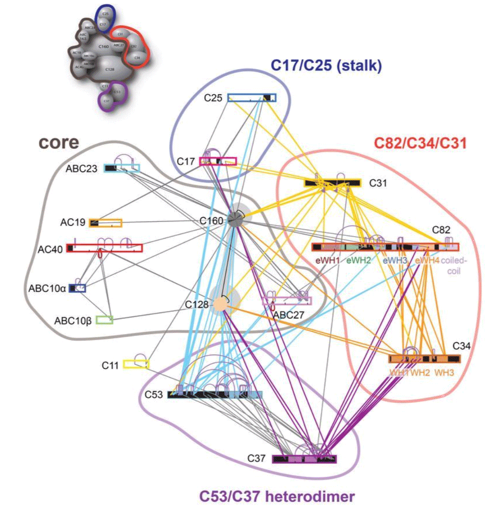
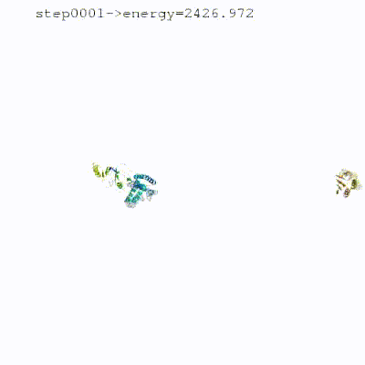
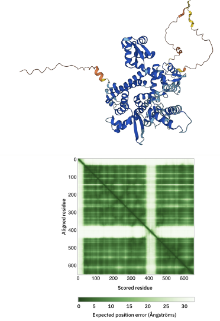
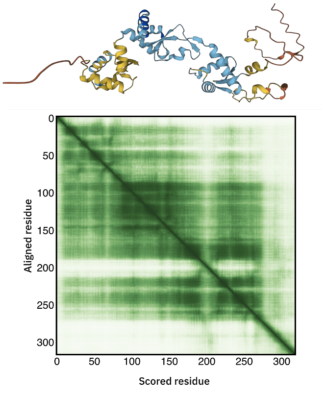
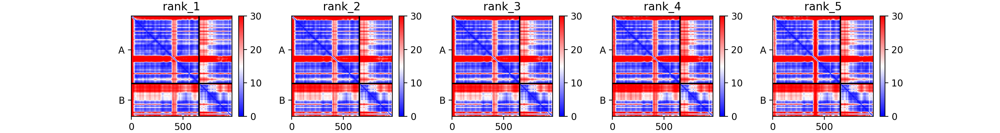
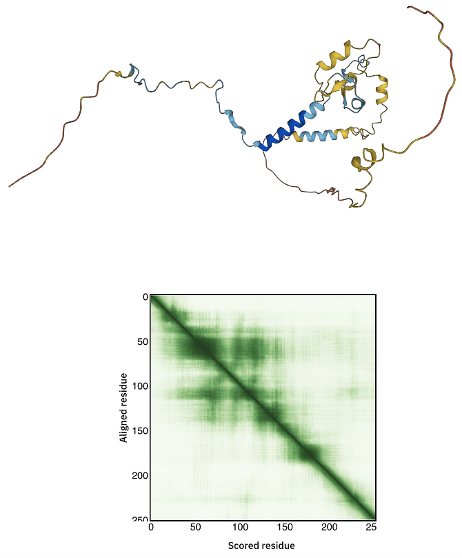
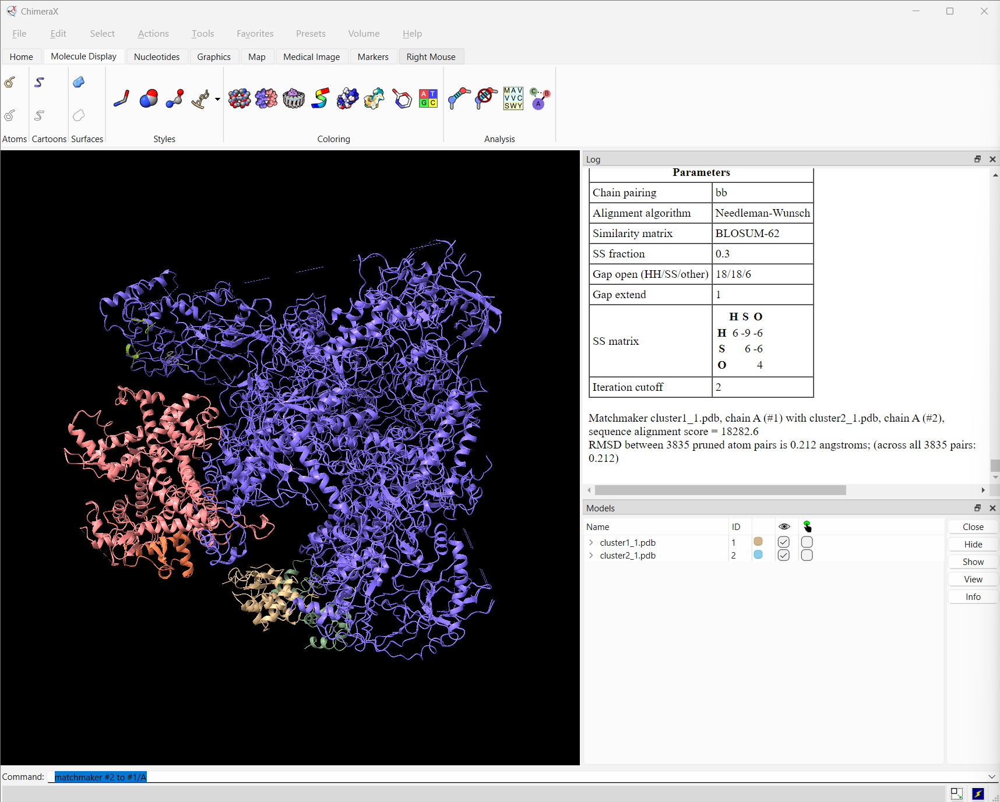
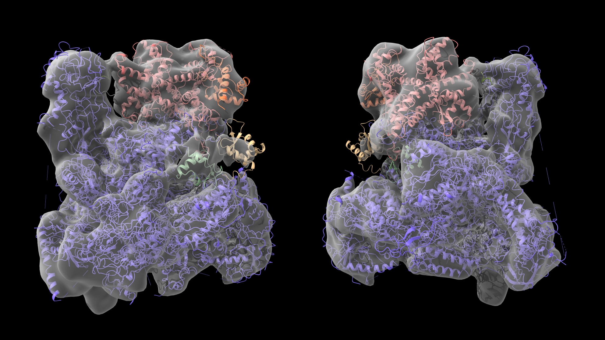

This tutorial consists of the following sections:

* table of contents
{:toc}

This tutorial was last updated on 09-11-2026.  

## Introduction

This tutorial will demonstrate the use of our DISVIS, POWERFIT and HADDOCK web servers for predicting the structure of a large biomolecular assembly from MS cross-linking data and low resolution cryo-EM data.
The case we will be investigating is the apo form of the <em>Saccharomyces cerevisiae</em> RNA Polymerase-III (Pol III). Pol III is a 17-subunit enzyme that transcribes tRNA genes. Its architecture can be subdivided into a core, stalk, heterodimer of C53 and C37, and heterotrimer of C82, C34, and C31 subunits.
<ul>
<figure align="center">
  
</figure>
<b>Figure 1:</b> Pol III subunits are shown as rectangular bars except for C160 and C128, which are shown as ovals for the sake of clarity. Inter-links are shown as lines connecting the protein bars, while intra-links are shown as curves. Inter-links to C31 are colored yellow, to C34 - gold, to C37 – violet, to C53 - cyan. The remaining inter-links are colored gray. Domains of C82 and C34 discussed in this work are explicitely represented. Regions missing in crystal structures or homology models are colored in black. The figure was created with xiNET. Figure reproduced from <a href="https://www.nature.com/articles/nmeth.3838" target="_blank">Ferber et al, 2016</a>.
 
 
</ul>

During this tutorial, we pretend that the structure of the Pol III core (14 subunits) is known. Therefore, we will focus on modeling the positioning of the C82/C34/C31 heterotrimer subunits relatively to the others (which we will treat as the core of Pol III). The structure of Pol III core is quite well characterized, with multiple cryo-EM structures of Pol III published.

We will be making use of i) our [DISVIS server](https://wenmr.science.uu.nl/disvis/){:target="_blank"} to analyse the cross-links and detect possible false positives and ii) of the new [HADDOCK2.4 webserver](https://wenmr.science.uu.nl/haddock2.4){:target="_blank"} to setup docking runs, using the coarse-graining option to speed up the calculations (especially needed due to the large size of the system). 
As an alternative strategy, we will use our [PowerFit server][link-powerfit-web]{:target="_blank"} to fit the largest components of the complex into the 9Å cryo-EM map and then use those as a starting point for the modelling of the remaining components.



Throughout the tutorial, colored text will be used to refer to questions or
instructions, and/or ChimeraX commands.

<a class="prompt prompt-question">This is a question prompt: try answering it!</a>
<a class="prompt prompt-info">This an instruction prompt: follow it!</a>
<a class="prompt prompt-pymol">This is a ChimeraX prompt: write this in the ChimeraX command line!</a>
<a class="prompt prompt-cmd">This is a Linux prompt: insert the commands in the terminal!</a>

## Setup/Requirements

In order to follow this tutorial you will need a **web browser**, a **text editor**, and [**ChimeraX**][link-chimerax]{:target="_blank"}
(both freely available for most operating systems) to visualize the input and output data. 
We used our [**pdb-tools**](https://github.com/haddocking/pdb-tools){:target="_blank"} to pre-process PDB files for HADDOCK, 
renumbering the core domains to avoid overlap in their residue numbering.
Ready to dock models are provided as part of the material for this tutorial. 
The required data to run this tutorial should be downloaded from [**here**](https://surfdrive.surf.nl/public.php/dav/files/Nio76AwEgDYwjvG){:target="_blank"}.
Once downloaded, make sure to unpack/unzip the archive (for Windows system you can install the [7-zip](https://www.7-zip.org){:target="_blank"} software if needed to unpack tar archives).

Also, if not provided with special workshop credentials to use the HADDOCK portal, make sure to register in order to be able to submit jobs. Use for this the following registration page: [https://wenmr.science.uu.nl/registration](https://wenmr.science.uu.nl/registration){:target="_blank"}.

## HADDOCK general concepts

HADDOCK (see [https://www.bonvinlab.org/software/haddock2.4](https://www.bonvinlab.org/software/haddock2.4){:target="_blank"}) is a collection of python scripts derived from ARIA ([https://aria.pasteur.fr](https://aria.pasteur.fr){:target="_blank"}) that harness the
power of CNS (Crystallography and NMR System, [http://cns-online.org/v1.3/](http://cns-online.org/v1.3/){:target="_blank"}) for structure
calculation of molecular complexes. What distinguishes HADDOCK from other docking software is its ability, inherited
from CNS, to incorporate experimental data as restraints and use these to guide the docking process alongside
traditional energetics and shape complementarity. Moreover, the intimate coupling with CNS endows HADDOCK with the
ability to actually produce models of sufficient quality to be archived in the Protein Data Bank.

A central aspect to HADDOCK is the definition of Ambiguous Interaction Restraints or AIRs. These allow the translation
of raw data such as NMR chemical shift perturbation or mutagenesis experiments into distance restraints that are
incorporated in the energy function used in the calculations. AIRs are defined through a list of residues that fall
under two categories: active and passive. Generally, active residues are those of central importance for the
interaction, such as residues whose knockouts abolish the interaction or those where the chemical shift perturbation is
higher. Throughout the simulation, these active residues are restrained to be part of the interface, if possible,
otherwise incurring in a scoring penalty. Passive residues are those that contribute to the interaction, but are of less importance. If such a residue does not belong in the interface there is no scoring penalty. Hence, a
careful selection of the active and passive residues is critical for the success of the docking.

The docking protocol of HADDOCK was designed so that the molecules experience varying degrees of flexibility and
different chemical environments, and it can be divided in three different stages, each with a defined goal and
characteristics:

* **1. Randomization of orientations and rigid-body minimization (it0)**  
In this initial stage, the interacting partners are treated as rigid bodies, meaning that all geometrical parameters
such as bonds lengths, bond angles, and dihedral angles are frozen. The partners are separated in space and rotated
randomly about their centers of mass. This is followed by a rigid body energy minimization step, where the partners are
allowed to rotate and translate to optimize the interaction.
The role of AIRs in this stage is of particular importance. Since they are included in the energy function being
minimized, the resulting complexes will be biased towards them. For example, defining a very strict set of AIRs leads
to a very narrow sampling of the conformational space, meaning that the generated poses will be very similar.
Conversely, very sparse restraints (e.g. the entire surface of a partner) will result in very different solutions,
displaying greater variability in the region of binding.

  

  

  <b><i>See animation of rigid-body minimization (it0):</i></b>
  

  <figure align="center">
    
  </figure>
  

   

* **2. Semi-flexible simulated annealing in torsion angle space (it1)**  
The second stage of the docking protocol introduces flexibility to the interacting partners through a three-step
molecular dynamics-based refinement in order to optimize the interface packing. It is worth noting that flexibility in
torsion angle space means that bond lengths and angles are still frozen. The interacting partners are first kept rigid
and only their orientations are optimized. Flexibility is then introduced in the interface, which is automatically
defined based on an analysis of intermolecular contacts within a 5Å cut-off. This allows different binding poses coming
from it0 to have different flexible regions defined. Residues belonging to this interface region are then allowed to
move their side-chains in a second refinement step. Finally, both backbone and side-chains of the flexible interface
are granted freedom.
The AIRs again play an important role at this stage since they might drive conformational changes.

  

  

  <b><i>See animation of semi-flexible simulated annealing (it1):</i></b>
  

  <figure align="center">
    
  </figure>
  

   

* **3. Refinement in Cartesian space with explicit solvent (water)**  
The final stage of the docking protocol allows to immerse the complex in a solvent shell to improve the energetics of the
interaction. HADDOCK currently supports water (TIP3P model) and DMSO environments. The latter can be used as a membrane
mimic. In this short explicit solvent refinement the models are subjected to a short molecular dynamics simulation at
300K, with position restraints on the non-interface heavy atoms. These restraints are later relaxed to allow all side
chains to be optimized. In the 2.4 version of HADDOCK, the explicit solvent refinement is replaced by default by a simple 
energy minimisation as benchmarking has shown solvent refinement does not add much to the quality of the models. This allows to save time.

  

  

  <b><i>See animation of refinement in explicit solvent (water):</i></b>
  

  <figure align="center">
    
  </figure>
  

   

The performance of this protocol depends on the number of models generated at each step. Few models are less
probable to capture the correct binding pose, while an exaggerated number will become computationally unreasonable. The
standard HADDOCK protocol generates 1000 models in the rigid body minimization stage, and then refines the best 200 
(ranked based on the HADDOCK score) in both it1 and water. Note, however, that while 1000 models are generated by default
in it0, they are the result of five minimization trials and for each of these the 180 degrees symmetrical solution is also
sampled. Thus, the 1000 models written to disk are effectively the sampling results of the 10.000 docking poses.

The final models are automatically clustered based on a specific similarity measure - either the *positional interface
ligand RMSD* (iL-RMSD) that captures conformational changes about the interface by fitting on the interface of the
receptor (the first molecule) and calculating the RMSDs on the interface of the smaller partner, or the *fraction of
common contacts* (current default) that measures the similarity of the intermolecular contacts. For RMSD clustering,
the interface used in the calculation is automatically defined based on an analysis of all contacts made in all models.

The new 2.4 version of HADDOCK also allows to coarse grain the system, which effectively reduces the number of 
particles and speeds up the computations. We are using for this the [MARTINI2.2 force field](https://doi.org/10.1021/ct300646g){:target="_blank"}, 
which is based on a four-to-one mapping of atoms on coarse-grained beads.

## The information at hand

Let us first inspect the available data, namely the various structures (or AlphaFold models) as well as
the information from MS we have at hand to guide the docking. After unpacking the archive provided for this tutorial (see [Setup](#setuprequirements) above),
you should see a directory called `RNA-Pol-III-2026` with the following subdirectories in it:

  * __cryo-EM__: This directory contains a 9Å cryo-EM map of the RNA Pol III (PolIII_9A.mrc).
  
  * __disvis__: This directory contains text files called `xlinks-*.txt` describing the cross-links between the domains named in the file name (e.g. `xlinks-core-C82.txt`).
These files are in the format required to run DISVIS. The directory also contains the results of the DISVIS analysis of the core and C82-C34wHTH3 in `results-core-C82-C34-wHTH3`

  * __docking__: This directory contains json files containing all the parameters and input data for HADDOCK. Those are reference files of the docking setup and allow to repeat the modelling using the `Submit File` option of the HADDOCK2.4 web server:
    * `RNA-PolIII-core-C82-C34-wHTHs-C31pept.json`: Docking as described in this tutorial
    
  * __input-pdbs__: This directory contains the HADDOCK-ready input PDB files for the various domains
    * `A_PolIII-5fja-core.pdb`: The core region of Pol III with non-overlapping residue numbering (chain A)
    * `B_C82-alphafold-trimmed.pdb`: The AlphaFold model of C82 excluding the disordered long loops (chain B)
    * `BC_C82-C34-alphafold-trimmed.pdb`: The AlphaFold-multimer model of C82 and C34 excluding the disordered long loops (chains B + C)
    * `BE_C82-C34-wHTH3-alphafold-trimmed.pdb`: The AlphaFold-multimer model of C82 and the third helix-turn-helix domain of C34 excluding the disordered long loops (chains B + E)
    * `C_C34_wHTH1-alphafold.pdb`: The AlphaFold model of the first helix-turn-helix domain of C34 (chain C)
    * `D_C34_wHTH2-alphafold.pdb`: The AlphaFold model of the second helix-turn-helix domain of C34 (chain D)
    * `F_C31_alphafold.pdb`: The AlphaFold model of C31 - an unreliable model (chain F)
    * `F_C31_alphafold-K91-peptide.pdb`: The peptide containing Lysine 91 from C31 AlphaFold model (chain F) 
    * `G_C31_alphafold-K111-peptide.pdb`: The peptide containing Lysine 111 from C31 AlphaFold model (chain G) 

  * __restraints__:
    * `xlinks-all-core-C82-C34-wHTH1-wHTH2-C31-K91-K111.tbl`: This file contains all cross-links between the core, C82, C34 domains 
                                                  and two peptides containing Lys 91 and Lys 111 from the C31 domain (chains F and G, respectively)
    * `C31-C34-connectivities.tbl`: Connectivity restraints between the C34 domains and between the C31 peptides
    * `restraints-combined.tbl`: The combination of those two files

* __AF-multimer__:
    * `C82-C34-wo-template`: AF-multimer run results for predicting C82-C34 binding.
    * `fasta-seqs`: Fasta sequences for the mobile monomers that can be used for further AF2 modeling.   

From MS, we have experimentally determined cross-links between the various domains. We have only kept  here  the inter-domain cross-links relevant for  this tutorial.
The cross-links are taken from ([Ferber et al. 2016](https://www.nature.com/articles/nmeth.3838){:target="_blank"}. These are the files present in the `disvis` directory. As an example here
are the cross-links identified between the core (chain A) and C82 (chain B):

<pre style="background-color:#DAE4E7">
A 5394 CB B 472 CB 0.0 30.0
A 5394 CB B 520 CB 0.0 30.0
</pre>

This is the format used by DisVis to represent the cross-links. Each cross-link definition consists of eight fields:

* chainID of the 1st molecule
* residue number
* atom name
* chainID of the 2nd molecule
* residue number
* atom name
* lower distance limit
* upper distance limit

## Inspecting the AlphaFold models

For C82, C34, and C31, we will make use of the AlphaFold models. Before downloading those models from the [AlphaFold Database](https://alphafold.ebi.ac.uk){:target="_blank"} and use them blindly for modelling, it is crucial to first carefully assess their quality. For docking purposes the disordered regions should be removed as those will only lead to problems during the modelling.

<a class="prompt prompt-question">
    How should we interpret AlphaFold's predictions? What are the predicted LDDT (pLDDT), PAE, iptm?
</a>

_Tip_: Try to find information about the prediction confidence at [https://alphafold.ebi.ac.uk/faq](https://alphafold.ebi.ac.uk/faq){:target="\_blank"}. A nice summary can also be found [here](https://www.rbvi.ucsf.edu/chimerax/data/pae-apr2022/pae.html){:target="\_blank"}.

Let's now take a look at the models for the three monomers that we want to dock (C82, C34, and C31).

### C82 AlphaFold model

The C82 AlphaFold model can be accessed [here](https://alphafold.ebi.ac.uk/entry/P32349){:target="\_blank"}.

<a class="prompt prompt-info">
Inspect the 3D model and in particular the color-coding which indicates the model confidence.
</a>

<a class="prompt prompt-info">
Also consider the Predicted aligned error displayed as a matrix.
</a>

<a class="prompt prompt-question">
   Can you identify the poorly predicted regions?
</a>

  

    <i>See the AlphaFold model and PAE plot</i>
   
  

  <figure align="center">
   
  </figure>
   

 

A trimmed model of C82 has been provided with the data for this tutorial. Inspect it in ChimeraX or your favourite 3D structure viewer. 

<a class="prompt prompt-question">
   What are the differences with the model from the AlphaFold database?
</a>

 
### C34 AlphaFold model

The C34 AlphaFold model can be accessed [here](https://alphafold.ebi.ac.uk/entry/P32910){:target="\_blank"}.

<a class="prompt prompt-info">
Inspect the 3D model and in particular the color-coding which indicates the model confidence.
</a>

<a class="prompt prompt-info">
Also consider the Predicted aligned error displayed as a matrix.
</a>

<a class="prompt prompt-question">
   Can you identify the poorly predicted regions?
</a>

  

    <i>See the AlphaFold model and PAE plot</i>
   
  

  <figure align="center">
   
  </figure>
   

 

C34 consists of three [winged-helix-turn-helix](https://en.wikipedia.org/wiki/Helix-turn-helix#Winged_helix-turn-helix){:target="\_blank"} (wHTH) domains. 

<a class="prompt prompt-question">
   Can you identify them in the model? 
</a>

__Tip__: In the AlphaFold page you can select a block in the PAE matrix that will automatically be highlighted in the model. 

<a class="prompt prompt-question">
   How well defined are the three wHTH domains? 
</a>

<a class="prompt prompt-question">
   How well defined are their relative orientations? The position of which wHTH domain is less well defined with respect to the others?
</a>

__Tip__: To assess how well defined the relative positions of the domains are consider the off-diagonal blocks of the PAE matrix connecting them. 

Since we do have a number of cross-links between wHTH1 and wHTH2, let's check if the AlphaFold model satisfies those.
For this we will inspect in ChimeraX the provided trimmed model of C34. 

Start ChimeraX and load the trimmed C82 model (`C_C34-alphafold-trimmed.pdb`):

<a class="prompt prompt-info"> ChimeraX menu -> File -> Open... -> select C_C34-alphafold-trimmed.pdb</a>

__Note:__ If using the command line, simply type:

<a class="prompt prompt-cmd">chimerax C_C34\-alphafold\-trimmed.pdb</a>

Let's now check if this model actually fit the cross-links identified between the first two wHTH domains.

In the ChimeraX command window type:

<a class="prompt prompt-pymol">
distance /C:62@CB /C:82@CB 
distance /C:62@CB /C:83@CB 
distance /C:62@CB /C:123@CB 
distance /C:65@CB /C:82@CB 
distance /C:65@CB /C:123@CB 
distance /C:65@CB /C:126@CB 
distance /C:65@CB /C:135@CB 
</a>

This will display the Euclidian distance between the two atoms in the Log display on your screen.
If you want to see the distances all together you can open the distance tool by typing the following in the ChimeraX command window:

<a class="prompt prompt-pymol">
ui tool show distance
</a>

The distances are not displayed yet in the model. This is because ChimeraX will only show those when the model is displayed in atom mode, which is off when you load your model. To set your model to atom mode, type the following in the ChimeraX command window:

<a class="prompt prompt-pymol">
show atoms
</a>

<a class="prompt prompt-info">
Now inspect the various cross-link distances.
</a>

<a class="prompt prompt-question">
Is the model satisfying the cross-link restraints?
</a>

<a class="prompt prompt-question">
If not, which ones are not satistified?
</a>

__Note__ that the reported distances are Euclidian distances. In reality, the cross-linker will have to follow the
surface of the molecule which might results in a longer effective distance. A proper comparison would require
calculating the surface distance instead. Such an analysis can be done with the [jwalk](https://github.com/Topf-Lab/Jwalk){:target="_blank"} 
or [nrgxl](https://nrgxl.pasteur.fr){:target="_blank"} software.

 
### C82-C34 AlphaFold-multimer model

We have generated this model using the [Colab version of Alphafold](https://github.com/sokrypton/ColabFold){:target="_blank"}. The results are provided in the data you downloaded in the `AF2-multimer/C82-C34-wo-template` directory. You can inspect the pdb models together with the png files, which contains the plDDT and PAE analysis calculated per model. For coloring the pdb files according to the plDDT scores, you can use the following ChimeraX command:

<a class="prompt prompt-info">
ChimeraX menu -> File -> Open... -> select C82C34_873a4_unrelaxed_rank_1_model_1.pdb
</a>

In the ChimeraX command window type:

<a class="prompt prompt-pymol">
color bfactor palette alphafold
</a>

<a class="prompt prompt-info">
Consider the Predicted aligned error displayed as a matrix.
</a>

<a class="prompt prompt-question">
   Can you identify the poorly predicted regions? Focus here on the different domains.
</a>

  

    <i>See the AlphaFold-multimer PAE plot</i>
   
  

  <figure align="center">
   
  </figure>

 

<a class="prompt prompt-question">
   Which one of the three C34 wHTH domain orientation is best defined with respect to C82? 
</a>

  

    <i>See answer</i>
  

   
  
From an analysis of the diagonal blocks we can identify the three wHTH domains, whose stucture is well predicted. When considering the off-diagonal blocks, the last domain of C34, wHTH3, seems to be the best defined with respect to C82. We will make use of this in our modelling strategy 2 in this tutorial. Since the orientation of the other domains are not well defined with respect with C82, we will treat them as separate entities during our modelling.

 

 

In the following, for the DisVis and PowerFit analyses, we will therefore use a model containing C82 and only the wHTH3 domain of C34.
This model is provided as `BE_C82-C34-wHTH3-alphafold-trimmed.pdb` in the `input-pdbs` directory (C82 as chain B and C34 wHTH3 as chain E).

 
### C31 AlphaFold model

The C31 AlphaFold model can be accessed [here](https://alphafold.ebi.ac.uk/entry/C7GXV1){:target="\_blank"}.

<a class="prompt prompt-info">
Inspect the 3D model and in particular the color-coding which indicates the model confidence.
</a>

<a class="prompt prompt-info">
Also consider the Predicted aligned error displayed as a matrix.
</a>

<a class="prompt prompt-question">
   How much trust to you have in this model?
</a>

  

    <i>See the AlphaFold model and PAE plot</i>
   
  

  <figure align="center">
   
  </figure>
   

 

It should be rather evident that the prediction confidence for C31 is low. As such it does not make sense to use it as is during the modelling.
But since there are a number of detected cross-links for this domain, in particular with the core and the C82 domains, we could consider including peptide fragments around the cross-linked lysines in the modelling. Two peptide fragments containing respectively K19 and K111 for which cross-links were detected can be found in the `input-pdbs` directory.

## Using DISVIS to visualize the interaction space and filter false positive restraints

### Introduction to DISVIS

DisVis is a software developed in our lab to visualise and quantify the information content of distance restraints
between macromolecular complexes. It is open-source and available for download from our [Github repository][link-disvis]{:target="_blank"}.
To facilitate its use, we have developed a [web portal][link-disvis-web]{:target="_blank"} for it.

DisVis performs a full and systematic 6 dimensional search of the three translational and rotational degrees of freedom to
determine the number of complexes consistent with the restraints. It outputs information about the inconsistent/violated
restraints and a density map that represents the center-of-mass position of the scanned chain consistent with a given
number of restraints at every position in space.

DisVis requires three input files: atomistic structures of the biomolecules to be analysed and a text file containing the list of distance restraints between the two molecules .
This is also the minimal required input for the web server to setup a run.  

DisVis and  its webserver are described in:

* G.C.P. van Zundert, M. Trellet, J. Schaarschmidt, Z. Kurkcuoglu, M. David, M. Verlato, A. Rosato and A.M.J.J. Bonvin.
[The DisVis and PowerFit web servers: Explorative and Integrative Modeling of Biomolecular Complexes.](https://doi.org/10.1016/j.jmb.2016.11.032){:target="_blank"}.
_J. Mol. Biol._. *429(3)*, 399-407 (2016).

* G.C.P van Zundert and A.M.J.J. Bonvin.
[DisVis: Quantifying and visualizing accessible interaction space of distance-restrained biomolecular complexes](https://doi.org/doi:10.1093/bioinformatics/btv333){:target="_blank"}.
  _Bioinformatics_ *31*, 3222-3224 (2015).

### Analysing the Pol III domain-domain interactions with DISVIS

Before modelling Pol III, we will first run DisVis using the cross-links for the various pairs of domains to both 
assess the information content of the cross-links and detect possible false positives. For the latter, please note that DisVis does not account for
conformational changes. As such, a cross-link flagged as possible false positive might also simply reflect a conformational change occuring upon binding.

We have cross-links available for 9 pairs of domains (see the `disvis` directory from the downloaded data). As an illustration of running DisVis, we will here
setup the analysis for the Pol III core (chain A) and the C82-C34wHTH3 model (chains B and E).

To run DisVis, go to

<a class="prompt prompt-info" href="https://wenmr.science.uu.nl/disvis" target="_blank">https://wenmr.science.uu.nl/disvis</a>

This page holds a short description of the server, how to cite it, and the submission form. You need to be logged in to see it.

#### Step1: Register to the server (if needed) or login

[Register][link-disvis-register]{:target="_blank"} for getting access to the web server (or use the credentials provided in case of a workshop).

If you are not logged in, the DisVis page shows the login form: click on its "**Register**" button and fill the required information.
After registering, you will receive an email with a link to confirm your email address and activate your account.

If you already have credentials, simply log in on the [DisVis page][link-disvis-submit]{:target="_blank"}.

#### Step2: Define the input files and parameters and submit

Once logged in, the [input form][link-disvis-submit]{:target="_blank"} is shown on the DisVis page.

From the `input-pdbs` directory select:

<a class="prompt prompt-info">Fixed chain → A_PolIII-5fja-core.pdb</a>
<a class="prompt prompt-info">Scanning chain → BE_C82-C34-wHTH3-alphafold-trimmed.pdb</a>

From the `disvis` directory select:

<a class="prompt prompt-info">Restraints → xlinks-core-C82.txt</a>

_Note_: There are no cross-links between the core and the wHTH3 domain of C34. The restraints file therefore only contains the cross-links between the core and C82.

Once the fields have been filled in, you can submit your job to our server
by clicking on "**Submit**" at the bottom of the page.

If the input fields have been correctly filled you should get a message
indicating that your run has been successfully submitted, and be redirected to a status page.
The status page checks the progress of the job every few seconds, and takes you to the results page once the job is done.
You can also find your job later in your [Workspace](https://wenmr.science.uu.nl/workspace){:target="_blank"}.
The runtime of this example case is about 1 minute on our server using CPUs. 
However the load of the server as well as pre- and post-processing steps might substantially increase the waiting time.

If you want to learn more about the meaning of the various parameters, you can go to:

<a class="prompt prompt-info" href="https://wenmr.science.uu.nl/disvis/" target="_blank">https://wenmr.science.uu.nl/disvis</a>

Then click on the "**Manual**" menu.

The rotational sampling interval option is in
degrees and defines how tightly the three rotational degrees of freedom will be
sampled. Voxel spacing is the size of the grid's voxels that will be cross-correlated during the 3D translational search.
Lower values of both parameters will cause DisVis to perform a finer search, at the
expense of increased computational time. The default values are `15°` and `2.0Å` for a quick scanning and `9.72°` and `1.0Å`
for a more thorough scanning ("**Quick scanning**" and "**Complete scanning**" in the "**Scanning**" section of the form;
the parameters can only be changed after selecting "**Custom scanning**").
For the sake of time, in this tutorial we will keep the default quick scanning settings (`15.00°` and `2.0Å`).
The number of processors used for the calculation is fixed to 4 processors on the web server side.
This number can of course be changed when using the local version of DisVis.

#### Analysing the results

Once your job has completed, and provided that you did not close the status page, you will be automatically redirected to the results
page (otherwise, open it from your [Workspace](https://wenmr.science.uu.nl/workspace){:target="_blank"}).

If you don't want to wait for your run to complete, you can access the results of a run with the same input
[**here**](https://wenmr.science.uu.nl/run/1857504){:target="_blank"}, or the pre-calculated results in the data folder you downloaded for this tutorial.
Look for the `disvis/results-core-C82-C34-wHTH3` directory and open the `report.html` file present in that directory.
This is the same report as shown on the results page. To display its 3D view, the report must be opened through a local web server
(and you need an internet connection). Start one from that directory:

<a class="prompt prompt-linux">
cd disvis/results\-core\-C82\-C34\-wHTH3 
python3 \-m http.server 
</a>

and open [http://localhost:8000/report.html](http://localhost:8000/report.html){:target="_blank"} in your web browser.
Stop the server with `Ctrl+C` when you are done.

The results page shows the DisVis report, followed by the output of the run and a "**Download**" button
for an archive with all input and output files. The report is split into several sections:

* `Options`: The parameters of the run (click on it to expand the list), followed by links to download the individual output files.
* `Accessible interaction space`: An interactive 3D view (Mol*) of the fixed chain together with the accessible interaction space,
in a density map representation (grey). Each view matches a specific level of N restraints, which corresponds
to the accessible interaction space of the complexes consistent with at least N restraints. The panel on the right of the viewer
describes the current view (the number of complexes consistent with at least N restraints) and lets you switch between
the views for the different N. You can rotate and zoom the scene with the mouse.
* `Accessible complexes`: Summary of the statistics for number of complexes consistent with at least N number of restraints.
 The statistics are displayed for all N levels, from the total number of restraints provided in the restraints file (here `xlinks-core-C82.txt`) down to 0.
* `Fraction of complexes violating each restraint`: The table in this sections shows how often a specific restraint is violated for all models consistent with
a given number of restraints. The higher the violation fraction of a specific restraint, the more likely it is to be a false positive.
If solutions have been found that are consistent with all restraints provided, this table should be ignored.
* `Z-scores`: For each restraint provided as input, a z-Score is provided, giving an indication of how likely it is that the restraint is a false positive.
The higher the score, the more likely it is that a restraint might be a false positive. Restraints with a z-Score above 1 are highlighted.
If DisVis finds complexes consistent with all restraints, the z-Scores are still displayed, but should be ignored.

The tables can be sorted by clicking on a column header.

<a class="prompt prompt-question"> Using the different descriptions of the sections we provided above together with the information
on the results page of your run, are there any likely false positive restraints according to DisVis?</a>

In our case, you should observe that DisVis found solutions consistent with both restraints submitted for the core-C82 interaction.

When DisVis fails to identify complexes consistent with all provided restraints during quick scanning, it is advisable to rerun with the complete scanning parameters before removing all putative false positive restraints (or remove only the most violated ones and rerun with complete scanning). It is possible that a more thorough sampling of the interaction space will yield complexes consistent with all restraints or at least reduce the list of putative false positive restraints.

Now look at the accessible interaction space in the 3D view of the report, and switch between the views for the different N
to see how adding restraints reduces it.

<a class="prompt prompt-question">
   How restrictive are the cross-links in defining the position of C82-C34wHTH3 around the core? Or put differently: How well-defined is the interaction space around the core?
</a>

_Remember_ that the displayed interaction space is the region where the center of mass of the second molecule can be put while satisfying the distance restraints, contacting and not clashing with the first molecule.

All input and output files, including the accessible interaction space as a density map (`accessible_interaction_space.mrc`), can be downloaded
with the "**Download**" button at the bottom of the results page, for example to analyse them further together with other structures.

### Converting DISVIS restraints into HADDOCK restraints

In principle you should repeat the DisVis analysis for all pairs to detect possible false positives. 
For the provided data, however, all cross-links can be satisfied simultaneously, i.e. DISVIS does not identify false positives.
Before setting up the docking, we need to generate the distance restraint file for the cross-links in a format suitable for HADDOCK.
HADDOCK uses [CNS][link-cns]{:target="_blank"} as its computational engine. A description of the format for the various restraint types supported by HADDOCK can
be found in our [Nature Protocols](https://www.nature.com/nprot/journal/v5/n5/abs/nprot.2010.32.html){:target="_blank"} paper, Box 4.

Distance restraints are defined as:

<pre>
assi (selection1) (selection2) distance, lower-bound correction, upper-bound correction
</pre>

The lower limit for the distance is calculated as: distance minus lower-bound correction
and the upper limit as: distance plus upper-bound correction

The syntax for the selections can combine information about chainID - `segid` keyword -, residue number - `resid`
keyword -, atom name - `name` keyword.
Other keywords can be used in various combinations of OR and AND statements. Please refer for that to the [online CNS manual][link-cns]{:target="_blank"}.

As an example, a distance restraint between the CB carbons of residues 10 and 200 in chains A and B with an
allowed distance range between 10 and 20Å can be defined as:

<pre>
assi (segid A and resid 10 and name CB) (segid B and resid 200 and name CB) 20.0 10.0 0.0
</pre>

<a class="prompt prompt-question">
Can you think of a different way of defining the target distance and its lower and upper corrections while maintaining the same
allowed range?
</a>

Under Linux (or OSX), this file can be generated automatically from a disvis restraint input file, e.g. `xlinks-core-C82.txt`
file provided with the data for this tutorial by giving the following command (one line) in a terminal window:

<a class="prompt prompt-linux">
cat xlinks\-core\-C82.txt| awk \'{if (NF == 8) {print \"assi (segid \",$1,\" and resid \",$2,\" and name \",$3,\") (segid \",$4,\" and resid \",$5,\" and name \",$6,\") \",$8,$8,$7}}\' > xlinks\-core\-C82.tbl
</a>

A pre-generated CNS/HADDOCK formatted restraints file containing all cross-links is available in the `restraints` directory as:

  * `xlinks-all-core-C82-C34-wHTH1-wHTH2-C31-K91-K111.tbl`
  
Inspect it (open it as a text file)

<a class="prompt prompt-question">
We used CB atoms to define the restraints in the disvis restraint file. Can you find those is this file?
Are there other atoms defined? What could those be? (Hint... MARTINI)
</a>

<b>See solution:</b>

 

Additional atoms are included in the distance restraints definitions: <i>BB</i>. These correspond to the backbone beads in the MARTINI representation.

 

In the restraints directory provided, there is additional restraint file provided: `C31-C34-connectivities.tbl`.
Inspect its content.

<a class="prompt prompt-question">
What are those restraints for?
</a>

<b>See solution:</b>

 

C34 consists of three winged-helix-turn-helix domains which could be docked separately in principle. These are connected by flexible linkers.
The defined restraints impose upper limits to the distance between the C- and N-terminal domains of the the domains. The upper limit was estimated as the number of missing segments/residues * 4.5Å (a typical distance observed in diffraction data for amyloid fibrils, representing a CA-CA distance in an extended conformation).
The same applies to C31 for which only two peptide fragments will be used to be able to make use of the cross-link restraints.

 

_Note_: You should notice that the restraints are duplicated (actually 4 times). This is a way to tell HADDOCK to give more weight to those restraints.

## Modelling the complex by docking with cross-links only, using as starting conformations the models fitted into the cryo-EM map

We will start by fitting the largest components (core and C82) into the 9Å cryo-EM map using our PowerFit web server.
This fitted models will then be used as input for the docking with cross-links, keeping those fixed at their original position.

### Introduction to PowerFit

PowerFit is a software developed in our lab to fit atomic resolution
structures of biomolecules into cryo-electron microscopy (cryo-EM) density maps.
PowerFit performs a rigid body fitting, calculating the
cross-correlation, a common measure of the goodness-of-fit, between the atomic
structure and the density map. It performs a systematic 6-dimensional scan of
the three translational and three rotational degrees of freedom. In short,
PowerFit will try to systematically fit the structure in different orientations at every position
in the map and calculate a cross-correlation score for each of them.

PowerFit is open-source and available for download from our [Github repository][link-powerfit]{:target="_blank"}.
To facilitate its use, we have developed a [web portal][link-powerfit-web]{:target="_blank"} for it.

The server runs the multi-core version of the software on our local resources.
It only requires a web browser to work and benefits from the latest
developments in the software, based on a stable and tested workflow. Next to providing an automated workflow around
PowerFit, the web server also summarizes and highlights the results in a single page including some visualization of the
PowerFit output using [MolViewSpec](https://molstar.org/mol-view-spec/){:target="_blank"}.

For more details about PowerFit and its usage we refer to a related [online tutorial](/education/Others/powerfit-webserver){:target="_blank"}.

### Fitting PolIII-core and C82+C34wHTH3 into the 9Å cryo-EM map

To run PowerFit, go to

<a class="prompt prompt-info" href="https://wenmr.science.uu.nl/powerfit" target="_blank">https://wenmr.science.uu.nl/powerfit</a>

On this page, you will find the most relevant information about the server as well as the submission form.

Once logged in, the [input form][link-powerfit-submit]{:target="_blank"} is shown on the PowerFit page.

Complete the form by filling the required fields and selecting the respective files
(most browsers should also support dragging the files onto the selection button):

<a class="prompt prompt-info">Input structure → A_PolIII-5fja-core.pdb</a>
<a class="prompt prompt-info">Cryo-EM map → PolIII_9A.mrc</a>
<a class="prompt prompt-info">Resolution (Å) → 9.0</a>

The other parameters are found under "**Optional Parameters**" (click "**Show**" to display them).
For this tutorial we keep their default values, including a rotational sampling of 10 degrees.

Once the fields have been filled in you can submit your job to our server
by clicking on "**Submit**" at the bottom of the page.

If the input fields have been correctly filled you should get a message
indicating that your run has been successfully submitted, and be redirected to a status page.
While performing the search, the PowerFit web server will update you on the progress of the
job by refreshing the status every few seconds. You can also close the page and find your job back later in your
[Workspace](https://wenmr.science.uu.nl/workspace){:target="_blank"}.
The runtime of this example case is below 2 minutes on our server. However the load of the server as well as
pre- and post-processing steps might substantially increase the time until the results are available.

While the calculations are running, you can have a look at the [PowerFit manual][link-powerfit-help]{:target="_blank"}
for the meaning of the various input parameters (including the ones under "**Optional Parameters**").
The rotational sampling interval is given in degrees and defines how tightly the three rotational degrees of freedom will be
sampled. Lower values will cause PowerFit to perform a finer search, at the expense of increased computational time.

#### Analysing the results

Once your job has completed, and provided you did not close the status page, you will be automatically redirected to the results
page (otherwise, open it from your [Workspace](https://wenmr.science.uu.nl/workspace){:target="_blank"}).
If you don't want to wait for your run to complete, you can access the results of a run with the same input
[**here**](https://wenmr.science.uu.nl/powerfit/result/1857601){:target="_blank"}.

The interactive results page shows the fitted solutions in the density map and a table with their scores.
The higher the cross-correlation score the better the fit. But also important is the Fisher z-score (the higher the better),
which, together with its associated number of standard deviations (σ difference), is an excellent indicator of the accuracy of a fit
(see for details [van Zundert and Bonvin, J. Struct. Biol. (2016)](https://doi.org/10.1016/j.jsb.2016.06.011){:target="_blank"}
and the [PowerFit manual][link-powerfit-help]{:target="_blank"}).
To enhance the interpretation of the results in the `Solutions` table, the entries are colored in a green gradient up to
a sigma difference of 3.

<a class="prompt prompt-question">
How well defined is the top solution for the core, judging from its σ difference with the next solutions?
</a>

<b>See solution:</b>

The σ difference of the top solution is 2.072, and it is highlighted in dark green in the <i>Solutions</i> table:
the top solution clearly stands out from the next ones and the fit of the core is thus well defined.

 

To inspect the solutions further, download the results archive to your computer using the "**Download**" button at the bottom of your results page.
You will find in it the following files:

* `fit_N.pdb`: the best *N* fits, judged by the cross-correlation score.
* `solutions.out`: all the non-redundant solutions found, ordered by their cross-correlation score, as comma-separated values.
* `lcc.mrc`: a cross-correlation map showing, at each grid position, the highest cross-correlation score found during the search,
thus showing the most likely location of the center of mass of the structure.
* `powerfit.log`: a log file of the calculation, including the input parameters with date and timing information.
* `report.html` and `state.mvsj`: the report shown on the results page, with its 3D view.

For convenience, we have already provided pre-calculated results in the `cryo-EM/powerfit-PolIII-core` directory in the data downloaded for this tutorial.
To view its `report.html` with the 3D view, start a local web server from that directory, as for DisVis:

<a class="prompt prompt-linux">
cd cryo\-EM/powerfit\-PolIII\-core 
python3 \-m http.server 
</a>

and open [http://localhost:8000/report.html](http://localhost:8000/report.html){:target="_blank"} in your web browser.
The `fit_1.pdb` file corresponds to the top solution predicted by PowerFit. You can inspect it and see how well it fits into the cryo-EM map
using `ChimeraX` with its `Fit in Map` tool (see instructions below).

<a class="prompt prompt-info">
Repeat the above procedure, but this time for the C82+C34wHTH3 AlphaFold model (BE_C82-C34-wHTH3-alphafold-trimmed.pdb).
</a>

The results of a run with this input are available [**here**](https://wenmr.science.uu.nl/powerfit/result/1857662){:target="_blank"},
and pre-calculated results in the `cryo-EM/powerfit-PolIII-C82-C34-wHTH3` directory.
For this model PowerFit finds only one solution.

### Refining the fit in ChimeraX

Let's see how well PowerFit performed in fitting and try to further optimize the fit using ChimeraX.

<a class="prompt prompt-info">
ChimeraX menu → File → Open... → Select the cryo-EM/powerfit-PolIII-core/fit_1.pdb
</a>
<a class="prompt prompt-info">
ChimeraX menu → File → Open... → Select the cryo-EM/powerfit-PolIII-C82-C34-wHTH3/fit_1.pdb
</a>
<a class="prompt prompt-info">
ChimeraX menu → File → Open... → Select the cryo-EM/PolIII_9A.mrc
</a>

__Note:__ Make sure you open the files in the above order, otherwise the ChimeraX commands will not work on the correct model. The # sign in the upcoming commands refer to the model number (#1 is the first opened model)

In the `Volume Viewer` window, the slide bar provides control on the
value at which the isosurface of the density is shown. At high values, the
envelope will shrink while lower values might even display the noise in the map.

First make the density transparent, in order to be able to see the fitted structure inside:

<a class="prompt prompt-pymol">
transparency #3 60
</a>

In order to distinguish the various chains color the structure by chain:

<a class="prompt prompt-pymol">
color bychain
</a>

The two molecules were fitted separately into the map, which can cause clashes at the interface.
ChimeraX can find all atom pairs between the core (#1) and C82+C34wHTH3 (#2) that overlap too much:

<a class="prompt prompt-pymol">
clashes #1 restrict #2 reveal true
</a>

The number of clashes is reported in the bottom bar of the ChimeraX window and
in the `Log`; the clashes are shown as pseudobonds between the atoms
(turn off the map by clicking on the "eye" in the Volume Viewer window to see them better).

<a class="prompt prompt-question">
How many clashes are there between the core and C82+C34wHTH3?
</a>

<b>See solution:</b>

ChimeraX reports 1370 clashes between the two PowerFit solutions: there are clearly several regions where the two molecules are clashing.

 

Now let's check the quality of the fit of the first molecule (fit_1#1) and try to improve the fit in ChimeraX:

<a class="prompt prompt-pymol">
ui tool show \"Fit in Map\"
</a>
<a class="prompt prompt-info">
Click the Options button
</a>
<a class="prompt prompt-info">
Select the Use map simulated from atoms and set the Resolution to 9
</a>
<a class="prompt prompt-info">
Click on Update and note the correlation value
</a>
<a class="prompt prompt-info">
Click on Fit and check if the correlation does improve
</a>
<a class="prompt prompt-question">
Has the quality of the fit measured by correlation coefficient improved?
</a>

<b>See solution:</b>

For the core, the correlation improves from 0.90 to 0.95 (the model is shifted by about 2.5Å and rotated by about 9°).
For C82+C34wHTH3, it improves from 0.93 to 0.94 (shift of about 2.3Å and rotation of about 5°).

 

Alternatively this can also be done using the ChimeraX command line:

<a class="prompt prompt-pymol">
fitmap #1 inMap #3 resolution 9 
close #4 
</a>

The correlation is shown underneath the command line

Repeat the clash analysis, first removing the clashes displayed before:

<a class="prompt prompt-pymol">
~clashes 
clashes #1 restrict #2 reveal true 
</a>

<a class="prompt prompt-question">
How many clashes are there now between the core and C82+C34wHTH3?
</a>

<b>See solution:</b>

481 clashes, compared to 1370 for the PowerFit solutions.

 

<a class="prompt prompt-info">
Repeat this procedure (fit and clash analysis) using the second molecule (fit_1#2) corresponding to the C82+C34wHTH3 model.
</a>

<a class="prompt prompt-question">
How many clashes are left after optimizing the fit of both molecules?
</a>

<b>See solution:</b>

438 clashes.

 

<a class="prompt prompt-question">
What about the clashes? Is the fit between core and C82 better in terms of clashes?
</a>

<b>See solution:</b>

The fit in ChimeraX has clearly removed many of the clashes: their number drops from 1370 to 481 after optimizing the fit of the core,
and to 438 after also optimizing the fit of C82+C34wHTH3. But there are still regions where the two molecules are clashing,
which we will resolve by refining the interface with HADDOCK.

 

Now save the two fitted molecules as a single complex. In order to use this file for refinement with HADDOCK,
both molecules must be saved as one model (with TER statements between the chains), and in the orientation of the density map.
For this, first combine the two molecules into one new model (#10, a number not used by the other models such as the simulated maps of the fits),
and then save it relative to the map (#3):

<a class="prompt prompt-pymol">
combine #1,2 modelId 10 name PolIII\-core\-C82\-C34\-wHTH3 
save PolIII\-core\-C82\-C34\-wHTH3\-chimera\-fitted.pdb models #10 relModel #3 
</a>

_Note_: ChimeraX saves the file in its current working directory, which is not necessarily the directory of the tutorial data
(e.g. it can be your Desktop or home directory). Type `pwd` in the ChimeraX command line to see where this is,
and `cd` followed by a directory name to change it before saving (or give the full path of the file in the `save` command).

_Note_: Saving the two molecules #1 and #2 directly (e.g. with File → Save) would write them as two separate models (with MODEL/ENDMDL statements),
which would first have to be merged into one model for HADDOCK.

A pre-processed PDB file is already available on disk in the `cryo-EM` directory: `PolIII-core-C82-C34-wHTH3-chimera-fitted.pdb`.

### Rescoring the fitted models with powerfit-score

The cross-correlation reported by PowerFit is calculated after applying a Laplace pre-filter to the density and
uses a core-weighted local cross-correlation score. These improve the detection of the correct fit, but give values
that cannot be directly compared with the correlation reported by ChimeraX.
Models can be scored again, at their current position and without any rotation or translation, with the `powerfit-score` command
of the PowerFit software. Turning off the Laplace pre-filter gives cross-correlation values more comparable with those of ChimeraX.

`powerfit-score` is installed together with PowerFit (requires Python 3.11 or later), for example in a virtual environment:

<a class="prompt prompt-linux">
python3 \-m venv powerfit\-env 
source powerfit\-env/bin/activate 
pip install powerfit\-em 
</a>

See the [PowerFit installation instructions](https://www.bonvinlab.org/powerfit/installation.html){:target="_blank"} for more details.

From the `cryo-EM` directory, score the top PowerFit solution for the core, first with the default settings of PowerFit
and then without the Laplace pre-filter:

<a class="prompt prompt-linux">
powerfit\-score PolIII_9A.mrc 9 powerfit\-PolIII\-core/fit_1.pdb 
powerfit\-score PolIII_9A.mrc 9 powerfit\-PolIII\-core/fit_1.pdb \-\-no\-laplace 
</a>

The scores are written as comma-separated values, with the same columns as the `solutions.out` file of PowerFit
(`cc` is the cross-correlation, followed by the Fisher z-score and the relative z-score). Use `--out scores.csv`
to write them to a file instead of the screen.

Repeat this for the top solution for C82+C34wHTH3 and for the combined model you fitted in ChimeraX:

<a class="prompt prompt-linux">
powerfit\-score PolIII_9A.mrc 9 powerfit\-PolIII\-C82\-C34\-wHTH3/fit_1.pdb \-\-no\-laplace 
powerfit\-score PolIII_9A.mrc 9 PolIII\-core\-C82\-C34\-wHTH3\-chimera\-fitted.pdb \-\-no\-laplace 
</a>

<a class="prompt prompt-question">
How do the cross-correlation values with and without the Laplace pre-filter compare? And how do those without it compare with the correlation reported by ChimeraX?
</a>

<b>See solution:</b>

Without the Laplace pre-filter, the cross-correlation is much higher: for the top solution for the core it goes from about 0.14 to 0.85,
and for C82+C34wHTH3 from about 0.42 to 0.91. These values are close to the correlations reported by ChimeraX for the same models
before fitting them further (0.90 and 0.93, respectively). The combined model fitted in ChimeraX scores about 0.90, against 0.95 in ChimeraX.
The two programs still calculate the correlation differently (simulated density, mask and grid), so the values are not identical.
Note also that even with the default settings, the score of <i>powerfit-score</i> (0.14 for the core) differs slightly from the one of the PowerFit search
in <i>solutions.out</i> (0.10): <i>powerfit-score</i> rebuilds the density and mask grids from the atomic coordinates instead of rotating precomputed ones.

 

### Refining the interface of the cryo-EM fitted models with HADDOCK

To refine the fitted models, we can use the [HADDOCK2.4 refinement interface](https://wenmr.science.uu.nl/haddock2.4/refinement/1){:target="_blank"} which offers different options to refine a complex.
Their performance to refine complexes obtained by individually fitting molecules into low to medium resolution EM maps is described in:

* T Neijenhuis, S.C. van Keulen and **A.M.J.J. Bonvin**. [Interface Refinement of Low-to-Medium Resolution Cryo-EM Complexes using HADDOCK2.4](https://doi.org/10.1016/j.str.2022.02.001){:target="_blank"}. _Structure_ *30*, 476-484 (2022).
 
Considering the size of the system we recommend in this case either the default `water refinement` or the `coarse-grained refinement`.
 
Connect to the [HADDOCK2.4 refinement interface](https://wenmr.science.uu.nl/haddock2.4/refinement/1){:target="_blank"} of the HADDOCK web server.

* **Step 1:** Define a name for your refinement run, e.g. *PolIII-core-C82-C34-wHTH3*.

* **Step 2:** Input the PDB file of the complex.

<a class="prompt prompt-info">
PDB structure to be refined ? -> <i>PolIII-core-C82-C34-wHTH3-chimera-fitted.pdb</i> (or the name of the complex you saved from ChimeraX)
</a>

* **Step 3:** Choose the refinement protocol

<a class="prompt prompt-info">
What protocol do you want to use? -> Coarse-grained refinement
</a>

Considering the size of the system, the coarse-grained refinement is much more efficient in this case.

<a class="prompt prompt-info">
Click on Next
</a>

The server will process the PDB files and recognize the number of chains and their type.

__Note__: Because of the size of the system, these refinement runs take quite some time to complete: about 2 hours for the coarse-grained refinement
and about 10 hours for the water refinement. **We therefore recommend to skip the submission step below and to proceed with the analysis of the pre-calculated runs.**

* **Step 4:** Submission

<a class="prompt prompt-info">
As nothing need to be changed further click on Submit
</a>

__Note__: The refinement interface allows to refine complexes consisting of various number of chains, but also single molecules. Also an ensemble of conformations can be submitted.

The result page of such a refinement can be found:

* default water refinement [**here**](https://wenmr.science.uu.nl/haddock2.4/result/4242424242/797710-PolIII-core-C82-C34-wHTH3){:target="_blank"}.
* coarse-grained refinement [**here**](https://wenmr.science.uu.nl/haddock2.4/result/4242424242/797712-PolIII-core-C82-C34-wHTH3-CG){:target="_blank"}.

<a class="prompt prompt-info">
Download the best model of your refinement run (or use the pre-calculated <i>PolIII-core-C82-C34-wHTH3-chimera-fitted-watref.pdb</i> or <i>PolIII-core-C82-C34-wHTH3-chimera-fitted-CGref.pdb</i> from the <i>cryo-EM</i> directory).
</a>

HADDOCK does not write the refined model in the position of the input model in the cryo-EM map: it is placed away from the density,
and the ChimeraX Fit in Map function cannot move it to the density when they are this far apart.
We will therefore first superimpose the refined model onto the model we fitted into the map in ChimeraX, and then optimize its fit.
Start a new ChimeraX session and open the files in this order (the model numbers in the commands below depend on it):

<a class="prompt prompt-info">
ChimeraX menu → File → Open... → Select the cryo-EM/PolIII_9A.mrc (#1)
</a>
<a class="prompt prompt-info">
ChimeraX menu → File → Open... → Select the cryo-EM/PolIII-core-C82-C34-wHTH3-chimera-fitted.pdb (#2)
</a>
<a class="prompt prompt-info">
ChimeraX menu → File → Open... → Select your refined model (#3)
</a>

Make the density transparent, in order to be able to see the structures inside, and color them by chain:

<a class="prompt prompt-pymol">
transparency #1 60 
color bychain 
</a>

Superimpose the refined model onto the fitted one, and then fit it into the map and check the correlation coefficient:

<a class="prompt prompt-pymol">
matchmaker #3 to #2 
fitmap #3 inMap #1 resolution 9 
</a>

For comparison, calculate also the correlation of the unrefined model, without moving it:

<a class="prompt prompt-pymol">
fitmap #2 inMap #1 resolution 9 shift false rotate false
</a>

_Note_: After each `fitmap` command, the correlation is shown in the bottom bar of the ChimeraX window, underneath the command line
(e.g. "24 steps, shift 0, rotation 0 degrees, correlation 0.9476"). The full results are also reported in the `Log`.

<a class="prompt prompt-question">
How do the correlation coefficients of the unrefined and refined models compare?
</a>

View the pre-calculated correlation coefficients for the various models:

 
<pre>
     PolIII-core-C82-C34-wHTH3-chimera-fitted.pdb:         0.9476
     PolIII-core-C82-C34-wHTH3-chimera-fitted-watref.pdb:  0.9474
     PolIII-core-C82-C34-wHTH3-chimera-fitted-CGref.pdb:   0.9511
</pre>
 

 

The aim of the refinement was to remove the clashes at the interface between the core and C82+C34wHTH3.
To check if it was successful, repeat the clash analysis, this time between the core (chain A) and C82+C34wHTH3 (chains B and E)
within the same model, first for the unrefined model and then for the refined one:

<a class="prompt prompt-pymol">
clashes #2/A restrict #2/B,E reveal true 
~clashes 
clashes #3/A restrict #3/B,E reveal true 
</a>

<a class="prompt prompt-question">
How many clashes are there between the core and C82+C34wHTH3 before and after refinement? Was the refinement successful?
</a>

<b>See solution:</b>

The unrefined model has 445 clashes between the core and C82+C34wHTH3. After refinement there are none left for the water-refined model,
and only two for the coarse-grained refined model. The refinement thus removed the clashes at the interface, while keeping the correlation with the cryo-EM map high.

 

### Checking the agreement of the refined cryo-EM fitted models with the cross-links

Let's now check if the EM-fitted model of core+C82+C34wHTH3 fits the two cross-links we have between those domains. Start a new ChimeraX session and load as described above `PolIII-core-C82-C34-wHTH3-chimera-fitted-CGref.pdb` (it will be model #1).

_Note_: To reset ChimeraX to its initial state without restarting it, close the current session (this closes all models):

<a class="prompt prompt-pymol">
close session
</a>

(or use ChimeraX menu → File → Close Session). The next file you open will then again be model #1.

In the ChimeraX command window type:

<a class="prompt prompt-pymol">
color bychain 
distance #1/B:472@CB #1/A:5394@CB 
distance #1/B:520@CB #1/A:5394@CB 
</a>

_Note_: If you continued instead in the session of the previous section, the refined model is model #3: replace then `#1` by `#3` in the above commands.
Without a model number, the commands would select the residues in all open models, and ChimeraX would report an error.

<a class="prompt prompt-info">
Inspect the various cross-link distances.
</a>

<a class="prompt prompt-question">
Is the model satisfying the cross-link restraints?
</a>

<a class="prompt prompt-question">
If not, which one(s) is(are) not satistified?
</a>

<b>See answer:</b>

 

Both cross-links are violated, but especially the one between core residue 5394  and C82 residue 472 (~70Å!).
The EM fitting solution for C82+C34wHTH3 was well defined according to PowerFit. There seems thus to be discrepancy between the EM and MS data.
Another explanation could be conformational changes in the structures that are not accounted for in our modelling.

 

 

### Setting up the full docking run using the cryo-EM fitted and refined core and C82 domains

We will setup a docking run to model the full complex including some information about the C31 cross-links and the missing two first wHTH domains of C34. For this we will use the PowerFit/ChimeraX, HADDOCK-refined structure (Core+C82+C34wHTH3) which we have generated as starting point. We will fix those domains in their original positions for the initial rigid-body docking stage and dock the two missing C34 wHTH domains including fragments of C31 for which we have cross-links.

Connect to the [HADDOCK2.4 interface](https://wenmr.science.uu.nl/haddock2.4/submit/1){:target="_blank"} of the HADDOCK web server.

#### Submission of structures

* **Step 1:** Define a name for your docking run, e.g. *RPolIII-EMfit-C34-wHTH1-wHTH2-C31-xlinks*.

* **Step 2:** Define the number of molecules -> *7*.

* **Step 3:** Input the first PDB file.

<a class="prompt prompt-info">
Which chain of the structure must be used? -> A
</a>
<a class="prompt prompt-info">
PDB structure to submit -> Browse and select from the cryo-EM directory <i>PolIII-core-C82-C34-wHTH3-chimera-fitted-CGref.pdb</i>
</a>
<a class="prompt prompt-info">
What kind of molecule are you docking? -> Protein-Nucleic acid
</a>
<a class="prompt prompt-info">
Do you want to coarse-grain your molecule? -> turn on   (this turns it on for all molecules)
</a>
<a class="prompt prompt-info">
Fix molecule at its original position during it0? -> turn on
</a>

* **Step 4:** Input the second PDB file.

<a class="prompt prompt-info">
Which chain of the structure must be used? -> B
</a>
<a class="prompt prompt-info">
PDB structure to submit -> Browse and select from the cryo-EM directory <i>PolIII-core-C82-C34-wHTH3-chimera-fitted-CGref.pdb</i>
</a>
<a class="prompt prompt-info">
Fix molecule at its original position during it0? -> turn on
</a>

* **Step 5:** Input the third PDB file.

<a class="prompt prompt-info">
PDB structure to submit -> Browse and select from the input-pdbs directory <i>C_C34_wHTH1-alphafold.pdb</i>
</a>

* **Step 6:** Input the fourth PDB file.

<a class="prompt prompt-info">
PDB structure to submit -> Browse and select from the input-pdbs directory <i>D_C34_wHTH2-alphafold.pdb</i>
</a>

* **Step 7:** Input the fifth PDB file.

<a class="prompt prompt-info">
Which chain of the structure must be used? -> E
</a>
<a class="prompt prompt-info">
PDB structure to submit -> Browse and select from the cryo-EM directory <i>PolIII-core-C82-C34-wHTH3-chimera-fitted-CGref.pdb</i>
</a>
<a class="prompt prompt-info">
Fix molecule at its original position during it0? -> turn on
</a>

* **Step 8:** Input the sixth PDB file.

<a class="prompt prompt-info">
PDB structure to submit -> Browse and select from the input-pdbs directory <i>F_C31_alphafold-K91-peptide.pdb</i>
</a>

* **Step 9:** Input the seventh PDB file.

<a class="prompt prompt-info">
PDB structure to submit -> Browse and select from the input-pdbs directory <i>G_C31_alphafold-K111-peptide.pdb</i>
</a>

* **Step 10:** Go to the next page.

<a class="prompt prompt-info">
Click on the "Next" button at the bottom left of the interface.
</a>

 
#### Definition of restraints

If everything went well, the interface window should have updated itself and it should show the list of residues for the various molecules.

* **Step 11:** Instead of specifying active and passive residues, we will supply restraint files to HADDOCK. 
No further action is required in this page:

<a class="prompt prompt-info">
Click on the "Next" button at the bottom of the <b>Input parameters</b> window
</a>

This proceeds to the **Distance Restraint** menu of the **Docking Parameters** window.

* **Step 12:** Upload the cross-link restraints file. Here we define the cross-links and connectivity restraints as unambiguous restraints so that all restraints will be used. If we were to define those as ambiguous, by default, for each model generated 50% of the restraints would be randomly deleted. We don't want this option here as we should have already identified problematic (false positive) restraints with DISVIS.

<a class="prompt prompt-info">
You can supply a HADDOCK restraints TBL file with restraints that will always be enforced (unambiguous restraints) -> Browse and select <i>restraints-combined.tbl</i>
</a>

 
#### Other docking settings and job submission

In  the same page as where restraints are provided you can modify a large number of docking settings.

* **Step 13:** Unfold the **sampling parameters** menu.

Here you can change the number of models that will be calculated, the default being 1000/200/200 for the three stages of HADDOCK (see [HADDOCK General Concepts](#haddock-general-concepts)). When docking multiple subunits, depending on the amount of information available to guide the docking, it is recommended to increase the sampling. For this tutorial we will use 4000/400/400 (but if you are using course accounts, this will be automatically downsampled to 250/50/50). 

<a class="prompt prompt-info">
Number of structures for rigid body docking -> 4000
</a>

<a class="prompt prompt-info">
Number of structures for semi-flexible refinement -> 400
</a>

<a class="prompt prompt-info">
Number of structures for the final refinement -> 400
</a>

<a class="prompt prompt-info">
Number of structures to analyze -> 400
</a>

When docking only with  interface information (i.e. no specific distances), we are systematically sampling the 180 degrees rotated solutions for each interface, minimizing the rotated solution and keeping the best of the two in terms of HADDOCK score. Since here we are using rather specific distance restraints, we can turn off this option to save time.

<a class="prompt prompt-info">
Sample 180 degrees rotated solutions during rigid body EM -> turn off
</a>

* **Step 14:** Unfold the **clustering parameters** menu.

The default clustering method is the Fraction of Common Contacts (FCC). Since we are dealing with multiple interfaces, to have a better discrimination of solutions we will increase the cutoff to 0.75.

<a class="prompt prompt-info">
Cutoff for clustering -> 0.75
</a>

__Note__: Because of the size of the system, this docking run takes quite some time to complete: about 22 hours in total.
**We therefore recommend to skip the submission step below and to proceed with the analysis of the pre-calculated run.**

* **Step 15:** Submission.

We are now ready to submit the docking run. Scroll to the bottom of the page.

<a class="prompt prompt-info">
Click on the "Submit" button at the bottom left of the interface.
</a>

Upon submission you will be presented with a web page which also contains a link to the haddockparameter file (containing all the parameters of the run) as well as some information about the status of the run.

Your run will first be queued but eventually its status will change to "Running" with the page showing the progress of the calculations.
The page will automatically refresh and the results will appear upon completion (which can take between 1/2 hour to
several hours depending on the size of your system and the load of the server). Since we are dealing here with a large complex, 
the docking will take quite some time (about 22 hours). So be patient. You will be notified by email once your job has successfully completed.

### First analysis of the docking results

Once your run has completed you will be presented with the result page. You can also access a pre-calculated run following the docking scenario just described from the following [**link**](https://wenmr.science.uu.nl/haddock2.4/run/4242424242/188552-RPolIII-EMfit-C34-wHTH1-wHTH2-C31-xlinks){:target="_blank"}.

<a class="prompt prompt-question">Inspect the result page</a>
<a class="prompt prompt-question">How many clusters are generated?</a>
<a class="prompt prompt-question">Consider the cluster scores and their standard deviations.</a>
<a class="prompt prompt-question">If there is more than one cluster, is  the top ranked cluster significantly better than the second one? (This is also reflected in the z-score).</a>

### Visualisation of docked models

Let's now visualize the various clusters. Download all clusters at once and unpack the archive.

Start ChimeraX and load each cluster representative (`clusterX_1.pdb`):

<a class="prompt prompt-pymol">ChimeraX menu \-> File \-> Open... \-> select cluster1_1.pdb</a>

Repeat this for each cluster. 

__Note:__ If using the command line, all clusters can be loaded easily in one command:

<a class="prompt prompt-cmd">chimerax cluster*_1.pdb</a>

Once all files have been loaded, type in the ChimeraX command window:

<a class="prompt prompt-pymol">
hide atoms 
show cartoon 
color bychain 
</a>

Let's then superimpose all models on chain A of the first cluster:

<a class="prompt prompt-pymol">
matchmaker #2 to #1/A 
</a>

This will align all clusters on chain A (PolIII-core), maximizing the differences in the orientation of the other chains. Be patient as given the size of the system this might take a bit of time...

__Note:__ If you want to align more models, you can extend the first model selection with a "-". For example, #2-4.

__Note__: You can also open in ChimeraX a session in which the models have already been fitted. Open for this the `clusters.cxs` file found in the `docking/RNA-PolIII-core-C82-C34-wHTHs-C31pept_summary` directory

<a class="prompt prompt-question">
Examine the various clusters. Compare the orientation of each domain (C82,C34 and the C31 peptides). 
How does their orientation differ between the various clusters?
</a>

__Reminder:__ Chain A corresponds to PolIII-core (medium slate blue), B to C82 (light coral), C to C34 wHTH1 (dark see green), D to C34 wHTH2 (burly wood), E to C34 wHTH3 (coral) and F and G (gray and olive drab) to C31.

<b>See ChimeraX view:</b>

<figure align="center">

 <i>ChimeraX view of the various clusters, superimposed on PolIII core</i>

</figure>

 
 

<a class="prompt prompt-question">
Which domain is the best defined over the various clusters?
</a>

<a class="prompt prompt-question">
Which domain is the worst defined over the various clusters?
</a>

<a class="prompt prompt-question">
How different are the solutions compared to those of Strategy1?
</a>

### Satisfaction of cross-link restraints

Let's now check if the solutions actually fit the cross-links we defined.
Start a new ChimeraX session and load as described above the model you want to analyze, e.g. the best model of the top
ranking cluster, `clusterX_1.pdb`.

#### Analysing the cross-links defining the position of the C82 domain

In the ChimeraX command window type:

<a class="prompt prompt-pymol">
color bychain 
hide atoms 
show cartoon 
distance /B:50@CB /F:91@CB 
distance /B:472@CB /A:5394@CB 
distance /B:520@CB /A:5394@CB 
distance /B:520@CB /D:135@CB 
distance /B:520@CB /D:138@CB 
distance /B:520@CB /D:141@CB 
distance /B:605@CB /F:91@CB 
distance /B:612@CB /G:111@CB 
ui tool show distance 
</a>

This will draw lines between the connected atoms and display the corresponding Euclidian distance.

<a class="prompt prompt-info">
Inspect the various cross-link distances.
</a>

<a class="prompt prompt-question">
Is the model satisfying the cross-link restraints?
</a>

<a class="prompt prompt-question">
If not, which ones are not satistified?
</a>

<b>See answer:</b>

 

The fit is better than in strategy 1, but thre is still one heavily violated cross-link between resid 472 of C82 and resid 5394 of the core. This might well be a false positive. It was not detected by DISVIS because the analysis is only performed for pair of domain and it can be satisfied, while when considering all molecules and all cross-links it can not.

 

#### Analysing the cross-links defining the position of the C34 wHTH1 domain

You can first hide the distances shown for C82 by pressing the "Delete" in the distance tool window.

In the ChimeraX command window type:

<a class="prompt prompt-pymol">
distance /C:62@CB /D:82@CB 
distance /C:62@CB /D:83@CB 
distance /C:62@CB /D:123@CB 
distance /C:65@CB /D:82@CB 
distance /C:65@CB /D:123@CB 
distance /C:65@CB /D:126@CB 
distance /C:65@CB /D:135@CB 
distance /C:65@CB /A:5394@CB 
</a>

<a class="prompt prompt-info">
Inspect the various cross-link distances.
</a>

<a class="prompt prompt-question">
Is the model satisfying the cross-link restraints?
</a>

<a class="prompt prompt-question">
If not, which ones are not satistified?
</a>

<b>See answer:</b>

 

In the case of C34 wHTH1, all cross-links are satisfied.

 

#### Analysing the cross-links defining the position of the C34 wHTH2 domain

You can first hide the distances shown for C82 by pressing the "Delete" in the distance tool window.

In the Chimerax command window type:

<a class="prompt prompt-pymol">
distance /D:123@CB /A:5394@CB 
distance /D:135@CB /B:520@CB 
distance /D:138@CB /B:520@CB 
distance /D:141@CB /B:520@CB 
</a>

<a class="prompt prompt-info">
Inspect the various cross-link distances.
</a>

<a class="prompt prompt-question">
Is the model satisfying the cross-link restraints?
</a>

<a class="prompt prompt-question">
If not, which ones are not satistified?
</a>

<b>See answer:</b>

 

In the case of C34 wHTH2, all cross-links are satisfied.

 

#### Analysing the cross-links defining the position of the C31 peptides

You can first hide the distances shown for C82 by pressing the "Delete" in the distance tool window.

In the Chimerax command window type:

<a class="prompt prompt-pymol">
distance /F:91@CB /A:1458@CB 
distance /F:91@CB /A:3402@CB 
distance /F:91@CB /A:4206@CB 
distance /F:91@CB /A:4359@CB 
distance /F:91@CB /A:4361@CB 
distance /F:91@CB /B:50@CB 
distance /F:91@CB /B:605@CB 
distance /G:111@CB /B:612@CB 
distance /G:111@CB /A:1458@CB 
distance /G:111@CB /A:3514@CB 
</a>

<a class="prompt prompt-info">
Inspect the various cross-link distances.
</a>

<a class="prompt prompt-question">
Is the model satisfying the cross-link restraints?
</a>

<a class="prompt prompt-question">
If not, which ones are not satistified?
</a>

<b>See answer:</b>

 

All cross-links are now stastified, including the one with C82 that was not in strategy 1.

 

### Fitting the docking models into low resolution cryo-EM maps

We will now fit the models we obained into the unpublished 9Å resolution cryo-EM map for the RNA Polymerase III apo state.
For this we will use the [UCSF ChimeraX][link-chimerax]{:target="_blank"} software.

For this open the PDB file of the cluster you want to fit and the EM map `PolIII_9A.mrc` (available in the `cryo-EM` directory).

<a class="prompt prompt-info">
  ChimeraX menu → File → Open... → Select the file
</a>

Repeat this for each file. Chimera will automatically guess their type.

Or you can open the files through the ChimeraX command line:

<a class="prompt prompt-pymol">
  open /path/to/clusterX_1.pdb
</a>
<a class="prompt prompt-pymol">
  open /path/to/PolIII_9A.mrc
</a>

In the `Volume Viewer` window, the slide bar provides control on the
value at which the isosurface of the density is shown. At high values, the
envelope will shrink while lower values might even display the noise in the map.

First make the density transparent, in order to be able to see the fitted structure inside:

<a class="prompt prompt-pymol">
transparency #density 60
</a>

In order to distinguish the various chains color the structure by chain:

<a class="prompt prompt-pymol">
color bychain
</a>

In order to perform the fit, we will use the Command Line more:

<a class="prompt prompt-pymol">
fitmap #model inMap #density search 5 
</a>

When the fit completes, a window will appear showing the fit results in terms of correlation coefficients.
Note the value for the cluster you selected.
You can also try to further improve the fit":

<a class="prompt prompt-pymol">
fitmap #model inMap #density resolution 9 
</a>

You can repeat this procedure for the various clusters and try to find out which solution best fits the map.
In case you upload multiple models simultaneously, make sure to use the correct model number in the above commands (check the Model Panel window for this).

<a class="prompt prompt-question">
Which model gives the best fit to the EM map?
</a>

<a class="prompt prompt-question">
What is the best correlation coefficient obtained?
</a>

<b>See the best model fit into the EM map:</b>

<figure align="center">

</figure>
 

View of cluster2_4 in the the EM map (correlation 0.9526). C82 and C34 wHTH3 domain (coral) nicely fit into the density. The other two C34 domains (dark see green and burly wood are found in a region where some density starts to appear seen when playing with the density level, which might indicate some disorder / conformational variability.

 
 

## Conclusions

We have demonstrated the use of cross-linking data from mass spectrometry for guiding the docking process in HADDOCK.
The results show that it is not straightforward to satisfy all cross-links.
In the original work of [Ferber et al. 2016](https://www.nature.com/articles/nmeth.3838){:target="_blank"} from which the cross-links were taken, many 
cross-links remained violated. See for example Suppl. Table 5 in  the corresponding [supplementary material](https://media.nature.com/original/nature-assets/nmeth/journal/v13/n6/extref/nmeth.3838-S1.pdf){:target="_blank"}. It is also possible that the cross-linking experiments might have captured transient or non-native interactions.

Our modelling here was based partially on models (from AlphaFold), which brings another level of complexity. Clearly some domains show much
more variability in their positions, which might explain why they are not seen in the cryo-EM density.

Using the cryo-EM data to pre-orient molecules prior to docking helps in the modelling of this complex system.

## Congratulations!

Thank you for following this tutorial. If you have any questions or suggestions, feel free to contact us via email, or post your question to
our [HADDOCK forum](https://ask.bioexcel.eu/c/haddock){:target="_blank"} hosted by the
{:target="_blank"} Center of Excellence for Computational Biomolecular Research.

[link-cns]: http://cns-online.org/v1.3/ "CNS online"
[link-chimerax]: https://www.cgl.ucsf.edu/chimerax/ "UCSF ChimeraX"
[link-disvis]: https://github.com/haddocking/disvis "DisVis GitHub repository"
[link-disvis-web]: https://wenmr.science.uu.nl/disvis "DisVis web server"
[link-disvis-submit]: https://wenmr.science.uu.nl/disvis "DisVis submission"
[link-disvis-register]: https://wenmr.science.uu.nl/registration "DisVis registration"

[link-haddock]: https://bonvinlab.org/software/haddock2.2 "HADDOCK 2.2"
[link-haddock-web]: https://wenmr.science.uu.nl/haddock2.4/ "HADDOCK 2.4 webserver"
[link-haddock-easy]: https://alcazar.science.uu.nl/services/HADDOCK2.2/haddockserver-easy.html "HADDOCK2.2 webserver easy interface"
[link-haddock-expert]: https://alcazar.science.uu.nl/services/HADDOCK2.2/haddockserver-expert.html "HADDOCK2.2 webserver expert interface"
[link-haddock-register]: https://wenmr.science.uu.nl/auth/register/"HADDOCK web server registration"
[link-molprobity]: https://molprobity.lbl.gov "MolProbity"
[link-powerfit]: https://github.com/haddocking/powerfit "PowerFit"
[link-powerfit-web]: https://wenmr.science.uu.nl/powerfit "PowerFit web server"
[link-powerfit-submit]: https://wenmr.science.uu.nl/powerfit "PowerFit submission"
[link-powerfit-help]: https://www.bonvinlab.org/powerfit/manual.html#using-the-webservice "PowerFit manual"

