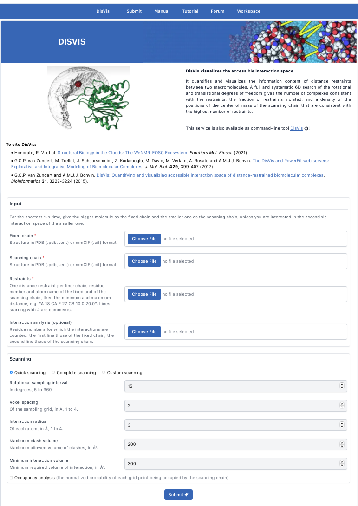
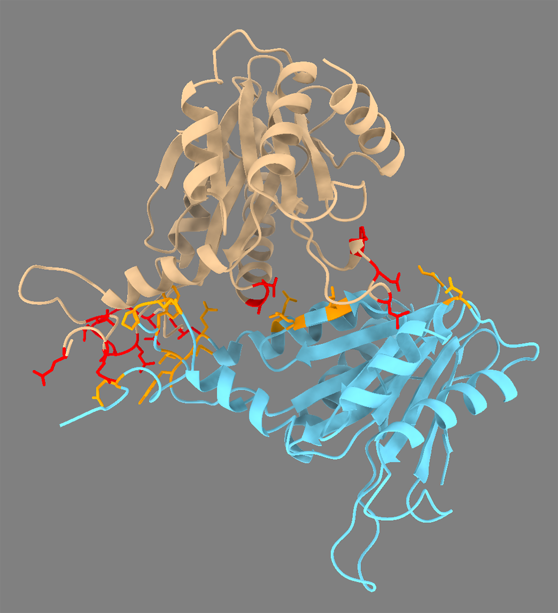

This tutorial consists of the following sections:

* table of contents
{:toc}

## Introduction

DisVis is a software developed in our lab to visualise and quantify the information content of distance restraints
between macromolecular complexes. It is open-source and available for download from our [Github repository][link-disvis]{:target="_blank"}.
To facilitate its use, we have developed a [web portal][link-disvis-web]{:target="_blank"} for it.

This tutorial demonstrates the use of the DisVis web server. The server runs the multi-core version of the software
on our local resources. It only requires a web browser to work and benefits from the latest
developments in the software based on a stable and tested workflow. Next to providing an automated workflow around DisVis,
the web server also summarises the DisVis output highlighting relevant information and providing an
interactive overview of the interaction space between the two molecules.

The case we will be investigating is the interaction between two proteins of the 26S proteasome of *S. pombe*, PRE5
(UniProtKB: [O14250](http://www.uniprot.org/uniprot/O14250)) and PUP2 (UniProtKB: [Q9UT97](http://www.uniprot.org/uniprot/Q9UT97)).
For this complex seven experimentally determined cross-links (4 ADH & 3 ZL) are available
([Leitner et al., 2014](https://doi.org/10.1073/pnas.1320298111)).
**We added two false positive restraints - it is your task to try to identify these!** For this, we use DisVis
to try to filter out these false positive restraints while assessing the true interaction space between the two chains.
We will then use the interaction analysis feature of DisVis that allows for a more complete analysis of the residues
putatively involved in the interaction between the two molecules. To do so, we will extract all accessible residues of
the two partners, and give the list of residues to DisVis using its interaction analysis feature.
Finally, we will show how the restraints can be provided to HADDOCK in order to model the 3D interaction between the
 2 partners.

DisVis and HADDOCK are described in:

* G.C.P. van Zundert, M. Trellet, J. Schaarschmidt, Z. Kurkcuoglu, M. David, M. Verlato, A. Rosato and A.M.J.J. Bonvin.
[The DisVis and PowerFit web servers: Explorative and Integrative Modeling of Biomolecular Complexes.](https://doi.org/10.1016/j.jmb.2016.11.032){:target="_blank"}.
_J. Mol. Biol._ *429(3)*, 399-407 (2017).

* G.C.P van Zundert and A.M.J.J. Bonvin.
[DisVis: Quantifying and visualizing accessible interaction space of distance-restrained biomolecular complexes](https://doi.org/doi:10.1093/bioinformatics/btv333){:target="_blank"}.
  _Bioinformatics_ *31*, 3222-3224 (2015).

* G.C.P. van Zundert, J.P.G.L.M. Rodrigues, M. Trellet, C. Schmitz, P.L. Kastritis, E. Karaca, A.S.J. Melquiond, M. van Dijk, S.J. de Vries, A.M.J.J. Bonvin.
[The HADDOCK2.2 webserver: User-friendly integrative modeling of biomolecular complexes.](https://doi.org/doi:10.1016/j.jmb.2015.09.014){:target="_blank"}
_J. Mol. Biol._ *428(4)*, 720-725 (2016).

Throughout the tutorial, coloured text will be used to refer to questions,
instructions, and ChimeraX commands.

<a class="prompt prompt-question">This is a question prompt: try answering
it!</a>
<a class="prompt prompt-info">This is an instruction prompt: follow it!</a>
<a class="prompt prompt-pymol">This is a ChimeraX prompt: write this in the
ChimeraX command line!</a>

## Setup/Requirements

In order to follow this tutorial you only need a **web browser**, a **text editor**, and [**UCSF ChimeraX**][link-chimerax]{:target="_blank"}
(freely available for most operating systems) on your computer in order to visualise the input and output data.  
Further, the required data to run this tutorial should be downloaded from [**here**](/education/disvis-webserver/disvis-tutorial.zip).
Once downloaded, make sure to unpack the archive.

## Inspecting the data

Let us first inspect the available data, namely the two individual structures as well as the distance restraints
we will provide as input.

Using ChimeraX, we can easily visualise the models and the identified cross-links, by navigating
ChimeraX's menus or simply entering the corresponding command in the ChimeraX command line.

For this open the PDB files `PRE5.pdb` and `PUP2.pdb`.

<a class="prompt prompt-info">
  UCSF ChimeraX Menu → File → Open... → Select the file
</a>

Repeat this for each file. ChimeraX will automatically guess their type.

**Note**: Make sure to load `PRE5.pdb` first and then `PUP2.pdb` in order for the subsequent commands
to work on the correct residues!

If you want to use the ChimeraX command line instead, type in it (it is at the bottom of the ChimeraX window):

<a class="prompt prompt-pymol">
  open /path/to/PRE5.pdb
</a>
<a class="prompt prompt-pymol">
  open /path/to/PUP2.pdb
</a>

From the command line you can also adjust the view to properly display both structures by entering:

<a class="prompt prompt-pymol">
view
</a>

As a first step, we will display and colour all residues involved in a cross-link. You can find the list of cross-links
in the file `restraints.txt`. The first column indicates the residues of PRE5 and the second column the
 residues of PUP2. To colour and display residues in ChimeraX, enter the following commands in the command line:

<a class="prompt prompt-pymol">
color #1:27,49,54,55,122,164 red  
show #1:27,49,54,55,122,164 atoms
</a>
<a class="prompt prompt-pymol">
color #2:18,49,125,127,128,169,179,188 orange  
show #2:18,49,125,127,128,169,179,188 atoms
</a>

PS: Make sure the identifiers match the models (#1 → PRE5 and #2 → PUP2). You can check them in the "**Models**" panel
(Tools → Models).

<a class="prompt prompt-question">
Does the location of the residues already suggest an interface or which residues might be part of the false positive restraints?
</a>
We will now try to assess the consistency of the restraints with DisVis and figure out which of those restraints might be false positives
thanks to an exhaustive analysis of the interaction space between the two molecules.

## Accessible interaction space search

DisVis performs a full and systematic 6 dimensional search of the three translational and rotational degrees of freedom to
determine the number of complexes consistent with the restraints. It outputs information about the inconsistent/violated
restraints and a density map that represents the center-of-mass position of the scanning chain consistent with a given
number of restraints at every position in space.

DisVis requires three input files: two high-resolution atomic structures of the biomolecules to be analysed (`PRE5.pdb` and
`PUP2.pdb`) and a text file containing the list of distance restraints between the two molecules (`restraints.txt`).
This is also the minimal required input for the web server in order to setup a run.  
To run DisVis, go to

<a class="prompt prompt-info" href="https://wenmr.science.uu.nl/disvis" target="_blank">https://wenmr.science.uu.nl/disvis</a>

This page holds a short description of the server, how to cite it, and the submission form. You need to be logged in to see it.

### Step1: Register to the server

[Register][link-disvis-register]{:target="_blank"} for getting access to the web server (or use the credentials provided in case of a workshop).

If you are not logged in, the DisVis page shows the login form: click on its "**Register**" button and fill the required information.
After registering, you will receive an email with a link to confirm your email address and activate your account.

### Step2: Define the input files and parameters and submit

Click on the "**Submit**" menu to access the [input form][link-disvis-submit]{:target="_blank"}.

<figure align="center">

</figure>

<a class="prompt prompt-info">Fixed chain → PRE5.pdb</a>
<a class="prompt prompt-info">Scanning chain → PUP2.pdb</a>
<a class="prompt prompt-info">Restraints → restraints.txt</a>

Each line of the restraints file defines one distance restraint: the chain, residue number and atom name of the fixed chain,
then those of the scanning chain, and finally the minimum and maximum distance (in Å). Lines starting with `#` are comments.

Once the fields have been filled in, you can submit your job to our server
by clicking on "**Submit**" at the bottom of the page.

If the input fields have been correctly filled you should get a message
indicating that your run has been successfully submitted, and be redirected to a status page.
The status page checks the progress of the job every few seconds, and takes you to the results page once the job is done.
You can also find your job later in your "**Workspace**".
The runtime of this example case is below 1 minute on our servers. However the load of the server as well as
pre- and post-processing steps might substantially increase the time until the results are available.

While the calculations are running, open a second tab and go to

<a class="prompt prompt-info" href="https://wenmr.science.uu.nl/disvis" target="_blank">https://wenmr.science.uu.nl/disvis</a>

Then click on the "**Manual**" menu.

Here, you can have a look at the several features and options of DisVis and read about the meaning of the various input
parameters. You can also go back to the [submission page][link-disvis-submit]{:target="_blank"}
and look at the parameters of the "**Scanning**" section: they can only be changed after selecting "**Custom scanning**".

The rotational sampling interval option is given in
degrees and defines how tightly the three rotational degrees of freedom will be
sampled. Voxel spacing is the size of the grid's voxels that will be cross-correlated during the 3D translational search.
Lower values of both parameters will cause DisVis to perform a finer search, at the
expense of increased computational time. The default values are `15°` and `2.0Å` for a quick scanning and `9.72°` and `1.0Å`
for a more thorough scanning ("**Quick scanning**" and "**Complete scanning**" in the form).
For the sake of time in this tutorial, we will keep the default quick scanning settings (`15.00°` and `2.0Å`).
The number of processors used for the calculation is fixed to 4 processors on the web server side.
This number can of course be changed when using the local version of DisVis.

## Analysing the results

### Web server output

Once your job has completed, and provided you did not close the status page, you will be automatically redirected to the results
page (you will also receive an email notification).

If you don't want to wait for your run to complete, you can access the precalculated results of a run submitted
with the same input [here](https://wenmr.science.uu.nl/disvis/result/1854818){:target="_blank"}.

The results page shows the DisVis report, followed by the output of the run and a "**Download**" button
for an archive with all input and output files. The report is split into several sections:

* `Options`: The parameters of the run (click on it to expand the list), followed by links to download the individual output files.
* `Accessible interaction space`: An interactive 3D view (Mol*) of the fixed chain together with the accessible interaction space,
in a density map representation (grey). Each view matches a specific level of N restraints, which corresponds
to the accessible interaction space of the complexes consistent with at least N restraints. The panel on the right of the viewer
describes the current view (the number of complexes consistent with at least N restraints) and lets you switch between
the views for the different N. You can rotate and zoom the scene with the mouse.
* `Accessible complexes`: Summary of the statistics for number of complexes consistent with at least N number of restraints.
 The statistics are displayed for all N levels, from the total number of restraints provided in the restraints file (here `restraints.txt`) down to 0.
* `Fraction of complexes violating each restraint`: The table in this sections shows how often a specific restraint is violated for all models consistent with
a given number of restraints. The higher the violation fraction of a specific restraint, the more likely it is to be a false positive.
Column 1 shows the number of consistent restraints N, while each following column indicates the violation fractions of
a specific restraint for complexes consistent with at least N restraints. Each row thus represents the fraction of all
complexes consistent with at least N restraints that violated a particular restraint. If solutions have been found
that are consistent with all restraints provided, this table should be ignored.
* `Z-scores`: For each restraint provided as input, a z-Score is provided, giving an indication of how likely it is that the restraint is a false positive.
The higher the score, the more likely it is that a restraint might be a false positive. Restraints with a z-Score above 1 are highlighted.
If DisVis finds complexes consistent with all restraints, the z-Scores are still displayed, but should be ignored.

The tables can be sorted by clicking on a column header.

It is possible to extract significant results from the results page of this initial run.

<a class="prompt prompt-question"> Using the different descriptions of the sections we provided above together with the information
on the results page of your run, what are likely false positive restraints according to DisVis?</a>

<a class="prompt prompt-question"> Do the results confirm your selection of residues putatively involved in false positive restraints
when you were initially looking at the structures in ChimeraX?</a>

As mentioned above, the two last sections feature a table that highlights putative false positive restraints based on
their z-Score and their violation frequency for a specific number of restraints. We will naturally look for the
crosslinks with the highest number of violations. The DisVis web server preformats the results in a way that false positive restraints
are highlighted and can be spotted at a glance.

In our case, you should observe that DisVis found solutions consistent with up to 7 of the 9 restraints, indicating that there are at least two false positive restraints.
Taking a closer look at the violations table might already be enough to determine which residues are most likely true false positives.
In this example two restraints are violated in all complexes consistent with 6 and 7 restraints and are thus the most likely candidates:

<b>See solution:</b>

<b>A164(CA) - B49(CA)</b>

<b>A49(CA) - B188(CA)</b>

When DisVis fails to identify complexes consistent with all provided restraints during quick scanning it is advisable to rerun with the complete scanning parameters before removing all putative false positive restraints (or remove only the most violated ones and rerun with complete scanning). It is possible that a more thorough sampling of the interaction space will yield complexes consistent with all restraints or at least reduce the list of putative false positive restraints.  

### DisVis output files

To analyse the accessible interaction space further, for example together with other structures,
download the results archive to your computer with the "**Download**" button at the bottom of your results page.
You will find in it, next to the input files (`fixed_chain.pdb`, `scanning_chain.pdb` and `restraints.dat`), the following files:

* `accessible_complexes.out`: A text file containing the number of complexes consistent with a number of restraints.
* `accessible_interaction_space.mrc`: A density file in MRC format. The density represents the center of mass of the
scanning chain conforming to the maximum number of consistent restraints at every position in space
* `disvis.log`: A log file showing all the parameters used, together with date and time indications.
* `violations.out`: A text file showing how often a specific restraint is violated for each number of consistent restraints.
* `z-score.out`: A text file giving the Z-score for each restraint. The higher the score, the more likely the restraint
is a false positive.
* `output.out`: The output of the run, also shown on the results page.
* `report.html` and `state.mvsj`: The report shown on the results page, and the scene of its 3D viewer. To view it offline, serve
the unpacked directory, e.g. with `python -m http.server -d <directory>`, and open `http://localhost:8000/report.html` in your browser.

Let us now inspect the solutions in ChimeraX:

<a class="prompt prompt-info">
  Open the *fixed_chain.pdb* file and the *accessible_interaction_space.mrc* density map in ChimeraX.
</a>

Use for this either the menus or the command line as explained [before](#inspecting-the-data).

The values of the `accessible_interaction_space.mrc` map correspond to the number of satisfied restraints (N).
In this way, you can selectively visualise regions where complexes have been found to be consistent with a given number of
restraints. Try to change the level with the slider of the "**Volume Viewer**" (Tools → Volume Data → Volume Viewer)
to see how the addition of restraints reduces the accessible interaction space. You can also set the level from the command line,
e.g. for the complexes consistent with at least 5 restraints (the map is model #2 when opened after `fixed_chain.pdb`):

<a class="prompt prompt-pymol">
volume #2 level 4.5
</a>

<a class="prompt prompt-question">
How many restraints do you need to significantly reduce the AIS? Can you explain why?
</a>

<b>See solution:</b>

 
The most significant difference can be seen when going from <b>4</b> to <b>5</b> restraints. By looking closer at the restraints,
we can see that two clusters of 3 and 4 residues exist. Once we add a fifth restraint, links from both clusters need to be
fulfilled. Thus, significantly reducing the accessible interaction space.

## Interaction analysis

We now have an idea of the accessible interaction space between the two molecules defined by the distance restraints.
We can however go further and try to identify what are the most important residues involved in this interaction. This information
might be useful to complement the distance restraints, for example in a docking run to model the complex.
To do so, we will use the `Interaction Analysis` feature of DisVis. By providing a list of residues, DisVis will analyse which ones
are most contacted in the solutions consistent with the provided distance restraints.

Go to:

<a class="prompt prompt-info" href="https://wenmr.science.uu.nl/disvis" target="_blank">https://wenmr.science.uu.nl/disvis</a>

We will use the same input as for the first run of DisVis, but removing this time the false positive
crosslinks identified at the previous step. The new set of restraints can be found in
`restraints_filtered.txt`:

<a class="prompt prompt-info">Fixed chain → PRE5.pdb</a>
<a class="prompt prompt-info">Scanning chain → PUP2.pdb</a>
<a class="prompt prompt-info">Restraints file → restraints_filtered.txt</a>

But, in addition, we will now provide a list of residues for the fixed and scanning chains.
These are defined in the text file `accessible_res_70.txt` provided with the tutorial data.
The residues we have selected are all residues considered as surface accessible for both the fixed
and the scanning chain. We used [NACCESS][naccess]{:target="_blank"} to compute the
solvent accessibility of each residue and selected the accessible ones using a threshold of 40% relative
accessibility for either the backbone or the side-chain.

<a class="prompt prompt-info">Interaction analysis (optional) → accessible_res_70.txt</a>

For this specific run, we will use the **Complete scanning** option. Leave the **Occupancy analysis** checkbox unticked
to keep the computation time in a reasonable window for this tutorial.

<a class="prompt prompt-info">Select the **Complete scanning** radio button</a>

Then click on the **Submit** button to start the run.

Once your job has completed, the results page will be displayed.
If you don't want to wait for your run to complete, you can see the results of a pre-calculated run
[here](https://wenmr.science.uu.nl/disvis/result/1854823){:target="_blank"} (this run also used the occupancy analysis).

<a class="prompt prompt-question">
Did the number of satisfied restraints change in comparison to the first quick scanning run?
</a>

Next to the previously described sections, the report now contains new tables for the fixed (receptor) and scanning (ligand) chains:

* `Most contacted residues`: The 10 residues with the most interactions in the complexes consistent with at least N restraints, most contacted first.
* `Average interactions per complex`: How many interactions a specific residue makes on average in the complexes
 consistent with at least N restraints. The higher the number of interactions of a specific residue is, the more
 likely it is to be part of the interface of the complex.

In the 3D view, the residues of the fixed chain are now coloured by their average number of interactions, from white to red.

Thanks to this new information, we can now identify putative key residues that should be part of the interface of the complex.
The tables can be sorted by their average number of interactions, which allows easy identification of the most important ones.
Depending on the downstream utilization you might be interested in all residues potentially involved in the interaction or a few of the
most likely ones. In this specific example considering residues with more than **0.5** interaction on average
in the complexes that comply with the maximum number of restraints, results in a reasonable list of residues to e. g. drive the
docking of both partners in a [HADDOCK][link-haddock-web]{:target="_blank"} docking run.

__Note__ _that in the context of using this information to drive the docking in HADDOCK, it is better to be too generous in the definition of the interface rather than too restrictive. Better results are expected if the "true" interface is properly covered. False predictions will not hurt the performance too much since by default HADDOCK will randomly delete for each model a fraction of the provided data._

<a class="prompt prompt-question"> How many key residues meeting the above mentioned criteria can you identify from the tables? </a>
<a class="prompt prompt-question"> Create a list of these residues for both the fixed and the scanning chain.</a>

<b>See solution:</b>

 
Respectively <b>16</b> and <b>14</b> residues have been identified as important for the interaction between <b>PRE5</b>
and <b>PUP2</b>:  

 PRE5 active residues: 7, 10, 13, 58, 60, 62, 82, 83, 125, 126, 127, 128, 129, 130, 131, 133  

 PUP2 active residues: 5, 11, 13, 15, 16, 17, 114, 121, 122, 123, 140, 152, 154, 177  

You can see the results <a href="https://wenmr.science.uu.nl/disvis/result/1854823" target="_blank" style="color:#294fa7">here</a>.

 

In order to check if those residues are indeed important for the interaction, we will highlight them in ChimeraX and use a
recently published [article](https://doi.org/10.15252/embj.201695222){:target="_blank"} (November 2016) structure of a homologue
of the 26S proteasome (from *S. cerevisiae*). This structure has been solved by X-ray crystallography at 2.4Å resolution (PDBid
[5L5A](http://www.rcsb.org/pdb/explore/explore.do?structureId=5L5A){:target="_blank"}). We will only use the two chains that are of interest,
chains **D** and **C** corresponding to **PRE5** and **PUP2** respectively, in PDB file `5l5a_CD.pdb`.

ChimeraX includes a tool to superimpose structures, allowing us to place our two partners onto the conformation extracted from the *S. cerevisiae* 26S proteasome.
Open a new ChimeraX session (or type `close` in the command line) and load the `PRE5.pdb`, `PUP2.pdb` and `5l5a_CD.pdb` as explained [previously](#inspecting-the-data).

<a class="prompt prompt-pymol">
  open /path/to/PRE5.pdb
</a>
<a class="prompt prompt-pymol">
  open /path/to/PUP2.pdb
</a>
<a class="prompt prompt-pymol">
  open /path/to/5l5a_CD.pdb
</a>

We will use the ['matchmaker'][link-chimerax-matchmaker]{:target="_blank"} command (also available from the menu Tools → Structure Analysis → Matchmaker),
which aligns the sequences of the two structures and superimposes them. To superimpose PRE5 onto chain D of 5L5A, type:

<a class="prompt prompt-pymol">
matchmaker #1 to #3/D
</a>

The result, including the RMSD, is reported in the ChimeraX log.

<a class="prompt prompt-question">
  What is the RMSD (Root Mean Square Deviation) between PRE5 and  chain D of 5L5A (in Å)?
</a>

To superimpose PUP2 onto chain C of 5L5A, type:

<a class="prompt prompt-pymol">
matchmaker #2 to #3/C
</a>

The superimposed structures may have moved out of view. Centre them again in the viewer with:

<a class="prompt prompt-pymol">
view
</a>

<a class="prompt prompt-question">
  What is the RMSD (Root Mean Square Deviation) between PUP2 and the chain C of 5L5A (in Å)?
</a>

We can see that *S. pombe* PRE5 and PUP2 monomers are quite close from the respective homologues in *S. cerevisiae*.

To ease the subsequent visualisation steps we will first hide the homologous structure `5l5a_CD.pdb`:

<a class="prompt prompt-pymol">
hide #3 models
</a>

(you can also untick its box in the "**Models**" panel, Tools → Models).

In a first step we will visualise the cross-links. This can be done by
drawing a line for each link identified between the corresponding residues.
We can again look at the file gathering the distance restraints to extract the information (`restraints.txt`).

To draw a line between two atoms in ChimeraX, we will use the ['distance'][link-chimerax-distance]{:target="_blank"} command.
To help you with the atom selection syntax, you can have a look at the ['atom specification'][link-chimerax-atomspec]{:target="_blank"}
section of the ChimeraX documentation.
Here are the commands you need to execute in order to draw all restraints:

<a class="prompt prompt-pymol">
distance #1:27@CA #2:18@CA
</a>
<a class="prompt prompt-pymol">
distance #1:122@CA #2:125@CA
</a>
<a class="prompt prompt-pymol">
distance #1:122@CA #2:127@CA
</a>
<a class="prompt prompt-pymol">
distance #1:122@CA #2:128@CA
</a>
<a class="prompt prompt-pymol">
distance #1:164@CA #2:49@CA
</a>
<a class="prompt prompt-pymol">
distance #1:55@CA #2:169@CA
</a>
<a class="prompt prompt-pymol">
distance #1:55@CA #2:179@CA
</a>
<a class="prompt prompt-pymol">
distance #1:54@CA #2:179@CA
</a>
<a class="prompt prompt-pymol">
distance #1:49@CA #2:188@CA
</a>

Each restraint present in the `restraints.txt` file should now be displayed in ChimeraX. For a better view of these restraints,
you can open the `Distances` tool:

<a class="prompt prompt-info">
UCSF ChimeraX Menu → Tools → Structure Analysis → Distances
</a>

And now change the radius, the number of dashes or the colour of the distance representations, or use the command line, e.g.:

<a class="prompt prompt-pymol">
distance style radius 0.3 dashes 0 color black
</a>

<a class="prompt prompt-question">
What is the distance of the false positive restraints? By how much does it exceed the cutoff specified in the restraints.txt file?
</a>

Now, we will determine whether the residues identified as active in our last DisVis run are coherent with the conformation of the complex
extracted from *S.cerevisiae*.

First select and colour the key residues identified by DisVis:

<a class="prompt prompt-pymol">
color #1:7,10,13,58,60,62,82,83,125,126,127,128,129,130,131,133 red
</a>
<a class="prompt prompt-pymol">
color #2:5,11,13,15,16,17,114,121,122,123,140,152,154,177 orange
</a>
<a class="prompt prompt-pymol">
show #1:7,10,13,58,60,62,82,83,125,126,127,128,129,130,131,133 atoms
</a>
<a class="prompt prompt-pymol">
show #2:5,11,13,15,16,17,114,121,122,123,140,152,154,177 atoms
</a>

See solution:

<figure align="center">
  
</figure>

 
<a class="prompt prompt-question">
  Are the residues given by DisVis consistent with the putative complex of PRE5 and PUP2?
</a>

## Additional challenge

If time permits try to superpose the reference structure on the fixed chain (`PRE5.pdb`) and load the accessible interaction space.

<a class="prompt prompt-question">
Does the accessible interaction space correspond to the position of the binding partner in the reference structure?
</a>

You can even rerun DisVis with the occupancy analysis option enabled and repeat the exercise with the generated `occupancy_N.mrc` files.
An example run with occupancy analysis can be found [here](https://wenmr.science.uu.nl/disvis/result/1854823){:target="_blank"}.

## Final remarks

We have demonstrated in this tutorial how to make use of the DisVis web server to:

1. [Identify false positive restraints](#accessible-interaction-space-search)
among a list of restraints obtained either experimentally or via bioinformatic methods and
2. [Identify key residues involved in the interaction](#interaction-analysis) among a list of accessible residues from the two partners.

One should keep in mind that false positive restraints highlighted by DisVis do not necessarily mean wrong restraints. It is
also possible that they reflect another binding site of the partners or another conformation of the complex.
The identification of different sets of restraints is possible with DisVis but it requires an iterative process in which you will have to
test different combinations of restraints.

As we have seen in the [last section](#interaction-analysis), one of the limitation of DisVis for identifying
key interacting residues is the lack of structural information in the output. DisVis can be a very powerful and accurate to
identify key residues involved in the interaction between two partners but it will not provide any contact information.
However, this is a very important first step for the purpose of generating a proper model of a complex.
Our docking program, [HADDOCK][link-haddock]{:target="_blank"}, also available as a [web server][link-haddock-web]{:target="_blank"},
can, for instance, take key residues identified by DisVis as input (defined as active in HADDOCK) to drive the docking, together with the original distance
restraints, in order to generate a biologically relevant model of your complex.
Several tutorials describing the use of HADDOCK are available from our [tutorial web page](http://bonvinlab.org/education){:target="_blank"}.
A basic introduction explaining how to define key residues and setup a docking run in HADDOCK is provided in the following
[tutorial][link-haddock-tutorial]{:target="_blank"}.

Thank you for following this tutorial. If you have any questions or suggestions, feel free to contact us via email, or post your question to
our [DisVis forum](http://ask.bioexcel.eu/c/disvis){:target="_blank"} hosted by the {:target="_blank"} center of excellence
for computational biomolecular research.

[link-disvis]: https://github.com/haddocking/disvis "DisVis GitHub repository"
[link-disvis-web]: https://wenmr.science.uu.nl/disvis "DisVis web server"
[link-disvis-submit]: https://wenmr.science.uu.nl/disvis "DisVis submission"
[link-disvis-register]: https://wenmr.science.uu.nl/registration "DisVis registration"
[link-chimerax]: https://www.cgl.ucsf.edu/chimerax/ "UCSF ChimeraX"
[link-chimerax-distance]: https://www.cgl.ucsf.edu/chimerax/docs/user/commands/distance.html "UCSF ChimeraX distance command"
[link-chimerax-atomspec]: https://www.cgl.ucsf.edu/chimerax/docs/user/commands/atomspec.html "UCSF ChimeraX atom specification"
[link-chimerax-matchmaker]: https://www.cgl.ucsf.edu/chimerax/docs/user/commands/matchmaker.html "UCSF ChimeraX matchmaker command"
[naccess]: http://www.bioinf.manchester.ac.uk/naccess/ "NACCESS"
[link-haddock]: http://bonvinlab.org/software/haddock2.4 "HADDOCK"
[link-haddock-web]: https://wenmr.science.uu.nl/haddock2.4 "HADDOCK2.4 webserver"
[link-haddock-tutorial]: http://bonvinlab.org/education/HADDOCK24/HADDOCK24-protein-protein-basic "HADDOCK2.4 webserver tutorial"
